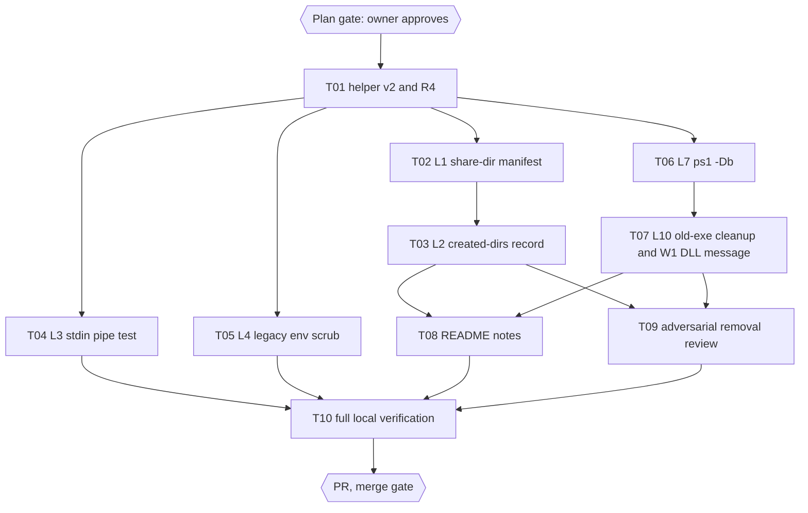

# Snipset CLI Deferred Hardening Plan

> For agentic workers: REQUIRED EXECUTION METHOD is delegated task execution, one chunk per task, parent-only git writes. Steps use checkbox syntax.

**Goal:** close eight deferred items from the install-coverage session (PR #6) plus one new Windows finding, each with a test that fails first.

**Architecture:** the installers stay generated bundles (`scripts/installer/build.mjs` from `scripts/installer/{sh,ps1}/` parts). The Linux installer gains two records it writes itself (`<share-dir>/.snipset-bundle`, `<install-dir>/.snipset-dirs`) so uninstall and reinstall can tell their own files and directories from the user's. The Windows installer gains `-Db` for MCP and check, cleanup of its own `snipset.exe.old-*` files, and a clear message when the exe cannot load its DLLs.

**Tech Stack:** bash 4.4+ parts, PowerShell 7 parts (tested with pwsh 7.6.6 on Linux), Bun 1.4.3 test runner.

**Active Project Profile:** repository `/home/belajarcarabelajar/Proyek/snipset-cli`, worktree `/home/belajarcarabelajar/Proyek/snipset-cli-wt/deferred-hardening`, branch `2026-10-12-snipset-cli-deferred-hardening/deferred-hardening` from `origin/main` at `1562bb1`; registry session `deferred-hardening` (claimed with `pr-registry.mjs claim`).

**Project Commands:** `timeout 200 bun test --timeout 30000 tests/<file>` (targeted), `bun test --timeout 60000 tests/` (whole suite, 522 pass 6 skip at `1562bb1`), `bun scripts/installer/build.mjs [--check] [--target sh|ps1] [--root DIR --out DIR]`, `bun scripts/packaging/render.mjs --check`, `shellcheck -S warning`, `pwsh -NoProfile -File tests/install.Tests.ps1` (with `POWERSHELL_TELEMETRY_OPTOUT=1`, `NO_COLOR=1`, a temp HOME).

**Protected boundaries:** never the real HOME or any real harness config; no real `mcp add`/`remove`; the private `~/Proyek/Snipset` repository is read only; no tag, release, winget, AUR, or tap action; no shell `rm` (temp dirs only through `fs.rm` in tests).

## 1. Intent Lock (owner answers, 2026-10-12)

**Requester intent (verbatim):** "Should we proceed The 14 deferred items?" then, at the `Deferred` question: "Local batch (Recommended), Add L5, L7, L10, L11 in vivera". L11 is its own session in vivera (`copy-rules-root`), not part of this plan.

Design answers (question set after grounding, 2026-10-12):

| Question | Answer |
|---|---|
| Linux (L1, L2) | Both records: L1 `.snipset-bundle` hash manifest, foreign files get `[KEEP]` and skip the shell block; L2 `.snipset-dirs` record, uninstall removes only recorded empty directories |
| Homebrew (L5) | README note: the Homebrew build needs host `libcrypto.so.3` and glibc 2.34 or newer; formula unchanged |
| Windows `-Db` (L7) | MCP and check only: `-Db` forwarded to MCP install, check, and uninstall; check reports the database file |
| Windows DLLs (W1) | Clear error plus README: `install.ps1` names the missing DLLs; the build fix goes to the backlog for the Snipset repository |

### Added behaviour not stated in the questions (L46, ask or drop)

- **L10 unique aside name:** the in-use rename becomes `snipset.exe.old-<pid>-<8 hex>` instead of `snipset.exe.old-<pid>`, because two updates in one PowerShell session reuse `$PID` and the second rename fails while the first aside still runs (grounding: `binary.ps1:39`). Approval of this plan approves it; rejecting it keeps the old name and only adds the cleanup.
- **L2 summary count:** each `[REMOVED] dir` line counts in the uninstall's `removed N` summary.

**Non-goals:** CI workflow changes; a formula `depends_on` or patchelf (L5 answer); a Windows `snipset init` step (L7 answer); fixing the Windows build's DLL imports (other repository); the other deferred items (L6, L8, L9, L11 to L13).

## 2. Visual Map

## 3. Acceptance Criteria and Traceability

| ID | Criterion | Task | Check |
|---|---|---|---|
| AC-1 | A user's own `snipset.sh`, `completion.bash`, or `tab.sh` in the share dir survives install and uninstall byte for byte, with a `[KEEP]` line, and the shell block is not written while one is kept | T02 | `tests/install-shell.test.mjs -t 'share dir manifest:'` |
| AC-2 | A newer release's shell files still replace the installer's own older ones (control) | T02 | same |
| AC-3 | After install then uninstall, every directory the installer created and that is empty is gone; directories that existed before, or hold a user file, remain | T03 | `tests/install-dirs.test.mjs` |
| AC-4 | Harness CLI calls under `bash -s` cannot read the rest of the script; a bundle without the redirect is shown to lose the trailer | T04 | `tests/install-stdin.test.mjs` |
| AC-5 | The 14 legacy tests keep their names and pass with a PATH that holds no entry of the caller's PATH | T05 | `tests/install.test.mjs` |
| AC-6 | `fakeWindowsRelease` writes the `*` marker; the platform suite uses it and has no local rewrite | T01 | `tests/install-sandbox.test.mjs`, `tests/install-ps1-platform.test.mjs` |
| AC-7 | `install.ps1 -Db X -WithMcp ...` writes `mcp --db X` into each harness entry; check and uninstall use the same `-Db`; check reports the database file; `-Db` with `"` is refused | T06 | `tests/install-ps1-db.test.mjs` |
| AC-8 | Only exact `snipset.exe.old-*` aside files next to the exe are deleted; locked ones are kept with a NOTE; decoys, directories, and links are untouched; two in-use updates leave at most one aside | T07 | `tests/install-ps1-hardening.test.mjs -t 'old-exe cleanup:'` |
| AC-9 | A loader exit code `-1073741515` (STATUS_DLL_NOT_FOUND) from the smoke run throws a message naming `libcrypto-3-x64.dll` and `VCRUNTIME140.dll` | T07 | `tests/install-ps1-hardening.test.mjs -t 'missing DLL:'` |
| AC-10 | README states the Homebrew requirement (host `libcrypto.so.3`, glibc 2.34+), the Windows DLL requirement, `-Db`, kept share files, and removed directories | T08 | `tests/readme-install.test.mjs -t 'deferred hardening:'` |
| AC-11 | No user file or pre-existing directory is lost on any path T02, T03, T07 touch | T09 | review report with reproductions |
| AC-12 | Full local verification | T10 | the nine `run[]` steps, every exit 0 |

## 4. Execution Waves

| Wave | Tasks | Writers | Disjoint files |
|---|---|---|---|
| 1 | T01 | one implementer | test helper, sandbox self-test, ps1 platform test |
| 2 | T02, T04, T05, T06 | four implementers in parallel | `shell.sh` + shell test; new stdin test; legacy test; ps1 params, modes, cli test, new db test |
| 3 | T03, T07 | two in parallel | sh parts lib, binary, shell, pathenv, mcp, modes + new dirs test; ps1 binary, modes + hardening test |
| 4 | T08, T09 | README writer, reviewer (read only) | README + readme test; review report |
| 5 | T10 | parent | none |

Rules for every chunk (carried from the install-coverage contracts and `MEMORY.md`):
- A chunk that edits an installer part tests against a **private bundle** of committed HEAD plus its own parts (`git show HEAD:<part>` into a temp root, `bun scripts/installer/build.mjs --target <sh|ps1> --root <tmp> --out <tmp>`, then `SNIPSET_INSTALL_SCRIPT` or the ps1 suite's own build). It never writes `install.sh` or `install.ps1`; the parent regenerates them at integration, one chunk at a time.
- Test first: the new test is run against HEAD and fails for the stated reason before any part changes. A guard on existing behaviour proves itself with a mutation in a private bundle instead.
- Temp HOME only, `fs.rm` cleanup inside tests, no shell `rm`, no git writes, no `gh`.
- pwsh runs carry `POWERSHELL_TELEMETRY_OPTOUT=1`, `NO_COLOR=1`, and `SNIPSET_INSTALL_ALLOW_NON_WINDOWS=1` where the suite needs it. ps1 parts keep the C13 rules: no `$script:`, never `exit`, failures throw.
- No em dash in any added line.
- Report: paths changed, RED and GREEN commands with exit codes and counts, deviations, `Not read:`.

## 5. Tasks

### Task T01: Helper v2 and R4
**Files:** Modify `tests/helpers/install-sandbox.mjs`, `tests/install-sandbox.test.mjs`, `tests/install-ps1-platform.test.mjs`. **Owner:** implementer.
**Behaviour:** the helper gains (a) `fakeLinuxRelease({ shellStubs })`, an object of file name to content for `snipset.sh`, `completion.bash`, `tab.sh` (default: today's fixture text); (b) `runInstallerPiped(sb, args, { script, trailer })`, which spawns `bash -s -- ...args` with a stdin pipe, writes the bundle text plus `trailer`, closes stdin, and returns the same shape as `runInstaller`; (c) an exported `linkTools(dir, tools = DEFAULT_TOOLS)` taken out of `makeSandbox`, used by `makeSandbox` unchanged; (d) `fakeWindowsRelease({ starMarker })` and an optional SHA256SUMS entry name for both fixtures (to cover the `*old-<archive>` guard). The platform suite replaces its local `useStarMarker` with the option. Self-tests named `helper v2: ...`.
**Evidence:** RED `-t 'helper v2:'` exit 1 (no such tests); GREEN sandbox suite and platform suite exit 0, the platform suite with the same test names and count.

### Task T02: L1 share-dir manifest
**Files:** Modify `scripts/installer/sh/shell.sh`, `tests/install-shell.test.mjs`; parent regenerates `install.sh`.
**Behaviour:** after placing the three shell files, the installer writes `<share-dir>/.snipset-bundle` with `<sha256>  <name>` per file (using `sha256_of` from `fetch.sh`). Before writing a file, it is the installer's own when it is absent, or a regular file (not a symlink) whose sha256 matches its manifest line, or byte-identical to the staged file, or (legacy fallback, no manifest) the share dir is the default `${HOME}/.local/share/snipset`. Anything else prints `[KEEP] shell <name>: <path> was not written by the installer` and is left untouched; while any file is kept, the bashrc block is not added (`[SKIP] shell block: ...`), matching the `pathenv.sh` rule for `env`. Uninstall removes only files whose sha256 matches the manifest, keeps the rest with `[KEEP]`, and removes the manifest once none of its files remain. `--check` reports a kept file the way `shims.sh` reports a foreign shim.
**Tests (names start `share dir manifest:`):** a user's `tab.sh` in a custom `--share-dir` survives install and uninstall byte for byte with `[KEEP]` and no bashrc block (RED on HEAD: overwritten, then deleted); a control where release B's different shell bytes replace release A's (uses `shellStubs`); a user edit to an installed file after install is kept on uninstall; the default share dir without a manifest still upgrades (legacy fallback).

### Task T03: L2 created-dirs record
**Files:** Modify `scripts/installer/sh/lib.sh`, `binary.sh`, `shell.sh`, `pathenv.sh`, `mcp.sh`, `modes.sh`; Create `tests/install-dirs.test.mjs`; parent regenerates `install.sh`.
**Behaviour:** a helper `mkdir_recorded DIR` finds the first existing ancestor, runs `mkdir -p`, and appends each directory it newly created to `<install-dir>/.snipset-dirs` (append and dedupe, never truncate; a path with a newline is created but not recorded). Every installer `mkdir -p` of a lasting directory goes through it (install dir, share dir, fish `conf.d`, `ZDOTDIR`, a custom `--bashrc` parent, `~/.config/opencode`, `~/.cursor`); temp and stage dirs do not. At the end of `--uninstall`, after the binary is removed: read the record, delete it, then for each recorded path, deepest first, that is in the candidate set recomputed from the current flags (each target directory and its ancestors, stopping before `$HOME` and `/`) and is a real directory, not a symlink, run `rmdir` (which refuses a non-empty directory) and print `[REMOVED] dir <path>`, counted in `removed N`. The existing share-dir `rmdir` calls run only when a record exists; with no record (an older install) today's behaviour stays.
**Tests:** empty sandbox HOME with seeded `.bashrc` and `.profile` and a `fish` stub: install `--add-path --with-mcp=opencode,cursor --no-init`, uninstall, and the directory list of the HOME snapshot equals the one before (RED on HEAD: `.local`, `.local/bin`, `.local/share`, `.config`, `.config/opencode`, `.config/fish`, `.config/fish/conf.d`, `.cursor` remain). Controls: an empty `~/.cursor/` seeded before install survives; a user file added to `~/.config/opencode/` keeps that directory; a hand-edited record naming a directory outside the candidate set (for example `<root>/outside`) is not removed.

### Task T04: L3 stdin pipe test
**Files:** Create `tests/install-stdin.test.mjs`.
**Behaviour:** stubs for `claude`, `codex`, `gemini`, `code` append `"$* <bytes read from stdin>"` to a log (`n=$(wc -c)`); `get` exits 1 so the entry looks absent, everything else exits 0. `runInstallerPiped` runs `--with-mcp=claude,codex,gemini,vscode --no-init --no-shims` with trailer `printf 'AFTER-SENTINEL\n'`, then `--uninstall` with the same flags. Every log line shows 0 bytes and stdout ends with `AFTER-SENTINEL`. **Positive control in the same file:** a bundle built from HEAD parts with `</dev/null` removed from `mcp_run` loses the sentinel (some stub reads more than 0 bytes). If the control cannot be made to fail, the chunk stops and reports, because the test would then prove nothing.

### Task T05: L4 legacy env scrub
**Files:** Modify `tests/install.test.mjs`.
**Behaviour:** `freshEnv` returns `{ HOME, PATH: fixture.binDir, LANG: "C", SNIPSET_RELEASE_BASE_URL }` after `linkTools(fixture.binDir)` (called after the curl stub is written, so a stub never writes through a tool symlink); the two inline envs use `freshEnv`; the `--help` test gets a temp HOME. One new test `legacy env is scrubbed: no caller PATH entry reaches the installer` asserts it. The 14 existing names are unchanged.

### Task T06: L7 `-Db` for MCP and check
**Files:** Modify `scripts/installer/ps1/params.ps1`, `modes.ps1`, `tests/install-ps1-cli.test.mjs`, `tests/install.Tests.ps1` (only if it lists parameters); Create `tests/install-ps1-db.test.mjs`; parent regenerates `install.ps1`.
**Behaviour:** `[string]$Db` with a `.PARAMETER Db` help entry; a value containing `"` throws, like `InstallDir`. `modes.ps1` passes `-Db $Db` to `Install-SnipsetMcp`, the check, and `Remove-SnipsetMcp` (today's call sites `modes.ps1:82`, `:97`, `:130`). Check mode prints `[SKIP] database: the CLI default` without `-Db`, `[OK] database: <path>` when the file exists, `[MISSING] database: <path>` otherwise (mirrors `db_check` in `db.sh`). No `snipset init` is run.
**Tests:** `-Db X -WithMcp cursor` writes `"args":["mcp","--db","X"]`; the same for one CLI harness through its stub; check with `-Db` reports OK and MISSING; uninstall with `-Db` removes the entry it wrote and keeps a differing one; `-Db 'a"b'` throws before any write; help lists `-Db`. RED: the parameter does not exist on HEAD.

### Task T07: L10 old-exe cleanup and W1 DLL message
**Files:** Modify `scripts/installer/ps1/binary.ps1`, `modes.ps1`, `tests/install-ps1-hardening.test.mjs`; parent regenerates `install.ps1`.
**Behaviour (L10):** the aside becomes `snipset.exe.old-<pid>-<8 hex>`. A new `Clear-SnipsetOldExe -InstallDir` lists direct children only, keeps names matching `^snipset\.exe\.old-\d+(-[0-9a-f]{8})?$` (regex, not a wildcard, so 8.3 names cannot match), skips directories and anything with a `LinkType`, and calls `Remove-Item -LiteralPath -Force` on each; an `IOException` or `UnauthorizedAccessException` keeps the file with one `[NOTE]`. It runs on a Windows host before `Move-SnipsetExe` in install and update, and in uninstall after `Remove-SnipsetExe` and before `Remove-SnipsetInstallDir`, where each deletion prints `[REMOVED]`.
**Behaviour (W1):** the `--version` smoke run moves into one function the tests can replace; when its exit code is `-1073741515` (`0xC0000135`, STATUS_DLL_NOT_FOUND) the installer throws `install.ps1: snipset.exe could not start: it needs libcrypto-3-x64.dll and VCRUNTIME140.dll, which this release does not ship; see the README Windows notes`, and the old exe stays in place as today.
**Tests (names start `old-exe cleanup:` and `missing DLL:`):** seeds `old-111` (deletable), a locked `old-222` (through a `Remove-Item` stub keyed on an env value), decoys `old-abc`, `old-111.txt`, `older`, `other.exe.old-1`, a directory `old-333`, a link `old-444` to a file outside, and `sub/snipset.exe.old-5`; only `old-111` goes, one NOTE for `old-222`, decoys byte-identical, `fail count: 0` (RED on HEAD: `old-111` survives). Two in-use runs leave at most one aside. Uninstall with a leftover aside removes it and the directory. The existing aside-name test regex follows the new name. A probe returning `-1073741515` throws the message and leaves the old exe byte-identical.

### Task T08: README notes
**Files:** Modify `README.md`, `tests/readme-install.test.mjs`.
**Behaviour:** the Homebrew row and notes state the build needs the host's `libcrypto.so.3` (OpenSSL 3) and glibc 2.34 or newer, and that the formula does not install them; the Windows rows state the exe needs `libcrypto-3-x64.dll` and `VCRUNTIME140.dll`, which the v0.2.0 zip does not ship (measured with `objdump -p`, not run on Windows); `-Db` is documented for `install.ps1`; the uninstall notes describe kept share files and the removal of empty directories the installer created (replacing "Empty directories may remain after uninstall" at `README.md:96` and the share-dir note at `:317`). Tests named `deferred hardening: ...` pin each statement.

### Task T09: Adversarial removal review
**Files:** Create `docs/code-plan/sessions/2026-10-12-snipset-cli-deferred-hardening/review.md`. **Owner:** reviewer (read only), at least two independent reviewers.
**Behaviour:** for every path T02, T03, T07 changed, try to lose a user file or a pre-existing directory in a temp HOME (a user file named like a shell file, a hand-edited manifest or record, a symlinked share dir, a share dir shared by two installs, a record naming `$HOME` or `/`, a locked aside, a decoy name). Each finding is reproduced with a command and rated P0 to P3 with the 8-point filter; P0 and P1 get a fix chunk with a failing test before T10.

### Task T10: Full local verification
**Files:** none. **Behaviour:** the nine `run[]` steps, run with `SNIPSET_REAL_ASSETS` pointing at the verified v0.2.0 assets; every exit code and count goes into the checklist.

## 6. Checklist

- [x] Explore: three read-only grounding reports (Linux items, Windows and Homebrew items, vivera L11), 2026-10-12.
- [x] Intent: owner answers recorded in section 1.
- [x] Plan gate: owner answered `Approve and execute (Recommended)` on 2026-10-12.
- [x] T01 helper v2 and R4. Evidence: RED `-t 'helper v2:'` exit 1 (matched 0, then 0 pass 8 fail with options ignored and `runInstallerPiped`/`linkTools` not functions); GREEN sandbox suite 36 pass, platform suite 23 pass with identical sorted names (junit), smoke of install, shell, mcp, ps1-mcp suites 82 pass; `useStarMarker` gone; helper 447 lines.
- [ ] T02 L1 share-dir manifest
- [ ] T03 L2 created-dirs record
- [x] T04 L3 stdin pipe test. Evidence: `tests/install-stdin.test.mjs` 3 pass against a HEAD-only bundle (equal to the committed `install.sh`): install makes 7 harness calls and uninstall 5 (three `remove` through `mcp_run`, stateful stubs from `tests/helpers/mcp-stubs.mjs`), each reading 0 bytes, stdout ending `AFTER-SENTINEL`. Positive controls: a HEAD bundle without the `mcp_run` redirect loses the 26-byte trailer to `claude mcp add` (install) and to `claude mcp remove` (uninstall); with the mutation turned off each control fails (`mcp_run kept its redirect`, `the mutated bundle kept the sentinel`).
- [x] T05 L4 legacy env scrub. Evidence: RED `-t 'legacy env is scrubbed'` exit 1 (13 caller PATH entries leaked, `~/.local/bin` twice); GREEN `tests/install.test.mjs` exit 0, 15 pass (the 14 names unchanged, sorted diff adds only the new one). Parent integration added `getconf`, `ldd`, `timeout` to the linked tools so the legacy tests keep the normal glibc check and the bounded smoke run (the chunk's default set took the fallback path).
- [ ] T06 L7 `-Db`
- [ ] T07 L10 old-exe cleanup and W1 DLL message
- [ ] T08 README notes
- [ ] T09 adversarial removal review
- [ ] T10 full local verification
- [ ] Deliver: commits by explicit path under the owner identity, no co-author trailer; PR body from a file with `--body-file`; registry `pr`.
- [ ] Sweep: debt sweep, learning ledger, closeout decision, graph index.

## 7. Risks and Decisions

| Risk | Answer |
|---|---|
| L1: a user who edits an installed shell file gets `[KEEP]` from then on | stated in the README; deleting the file returns it to the installer |
| L1: a pre-manifest install in a custom share dir gets `[KEEP]` once | same hint; the default share dir has the legacy fallback |
| L2: a tampered record could name a directory outside the install | removal is limited to the candidate set recomputed from the flags, real directories only, `rmdir` only |
| L2: some `~/.profile` templates add `~/.local/bin` to PATH only when it exists | the directory is removed only when the installer created it and it is empty |
| L3: the sentinel models leftover script text, not a TTY hang | stated in the test header; a pty test is out of scope |
| L7 and W1: Windows behaviour cannot run here | the README labels stay "not verified"; tests replace the Windows-only functions as the existing suites do |
| W1: `0xC0000135` is only one loader failure (others: `0xC0000139` entry point) | the message covers the measured case; other codes keep today's generic failure |
| The Windows exe needs DLLs it does not ship | backlog item for the Snipset release build: link OpenSSL and the CRT statically, or ship the DLLs in the zip |

## 8. Approval

Approved by the owner at the `Plan` gate, 2026-10-12 (`Approve and execute (Recommended)`), including the two added behaviours in section 1.
