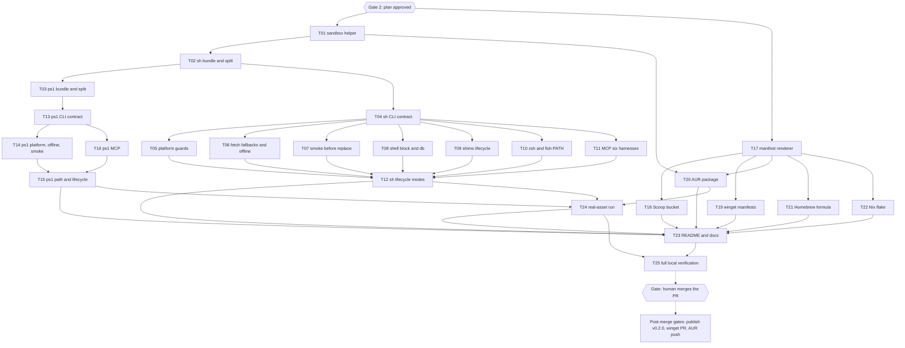

# Snipset CLI Install Coverage Plan

> For agentic workers: REQUIRED EXECUTION METHOD is delegated task execution in waves (section 4). The parent commits, stages by explicit path, regenerates the bundles, and never merges. Subagents edit only their permitted files and run tests; they never run git or gh, and never write `install.sh`, `install.ps1`, or any rendered manifest output owned by another task.

**Goal:** snipset-cli installs across tool availability, shells, OS and CPU, network, and harness mixes through several channels, and every path is checkable, reversible, and labelled "verified" or "not verified" truthfully.

**Spec:** section 1 of this plan (intent lock approved at Gate 1, 2026-10-12) and `docs/code-plan/research/2026-10-12-install-coverage-research.md`.

**Architecture:**
- Users keep downloading one file (`install.sh`, `install.ps1`). Both become **generated bundles**: source parts live in `scripts/installer/sh/*.sh` and `scripts/installer/ps1/*.ps1`, `scripts/installer/build.mjs` concatenates them in the order of each `ORDER` file, and `--check` fails on drift. This keeps every part under 500 lines and gives each parallel chunk its own file.
- Install state is derived from disk, never recorded: shims by their generator header plus `<dir>/.snipset-shims`, the bashrc block by its marker, PATH lines by exact text, env files by exact content, MCP entries by a command equal to the installed binary path.
- Package manifests are rendered from `packaging/VERSION` and `packaging/SHA256SUMS` by `scripts/packaging/render.mjs`, which discovers one template directory per channel under `packaging/templates/<channel>/` (a `target.json` plus templates) and fails `--check` on drift or orphaned output.

**Tech Stack:** bash (bundle needs bash 4.4+, checked at start since review wave 1 B5; parts are `# shellcheck shell=bash` fragments), PowerShell 7.6.6 here (target: Windows PowerShell 5.1 and PowerShell 7), Bun 1.4.3 (`bun:test`), ShellCheck, makepkg 7 with fakeroot (Arch, present).

**Active Project Profile:** repo `/home/belajarcarabelajar/Proyek/snipset-cli` (public, EULA, no tags, one Draft release `v0.2.0`), session worktree `/home/belajarcarabelajar/Proyek/snipset-cli-wt/install-coverage`, branch `2026-10-12-snipset-cli-install-coverage/install-coverage`, base `main` at `8db8138`. No `user.name`/`user.email` in this repo's git config: commits use `-c user.name='Iwan Kurniawan' -c user.email='110369962+belajarcarabelajar@users.noreply.github.com'`, the identity of every earlier commit. Machine: Arch Linux x86_64, glibc above 2.34, bun 1.4.3, pwsh 7.6.6 at `~/.local/bin/pwsh`, shellcheck, makepkg, fakeroot, jq, gh; absent: docker, podman, brew, ruby, scoop, winget, nix, mise, eget, ubi, namcap.

**Project Commands:** `timeout 120 bun test --timeout 30000 tests/<file>` (targeted, MEMORY A12), `bun test tests/` (whole suite, 114 tests at baseline), `bun scripts/installer/build.mjs [--check] [--target sh|ps1]`, `bun scripts/packaging/render.mjs [--check] [--channel <id>]`, `shellcheck -S warning <file>`, `bash -n <file>`, plan tooling from `~/vivera/scripts/` (`ultra-plan-runner.mjs`, `plan-publish.mjs`, `plan-issue-sync.mjs`, `pr-registry.mjs`, `plan-closeout.mjs`).

**Protected Boundaries:** tests never touch the real HOME (every test uses a temp HOME and the T01 helper refuses any HOME outside the temp dir); no test uses the network (fixtures, loopback servers, `file://`); no task writes to `~/.claude.json`, `~/.codex`, `~/.gemini`, `~/.cursor`, `~/.config/Code`, or `~/.config/opencode` on the real machine; no task creates a tag, publishes the release, opens a winget PR, pushes to the AUR, or creates a repository; the private `Snipset` repo is read, never edited; `.github/workflows/test.yml` is not edited (Gate 1: labels only); the database is never written by uninstall or check.

**Scope:** workstreams A to D of section 1 plus every Gate 1 option: Scoop, AUR, winget, Homebrew, zsh and fish PATH, MCP for six harnesses, zero-manifest docs, Nix flake.

**Non-Goals:** section 1 non-goals, plus: CI workflow changes (Gate 1 chose labels only), a dedicated `homebrew-tap` repository (externally visible; post-merge option), a `flake.lock` (cannot be generated without nix).

## Contract

**Linux CLI.** `install.sh [--version V] [--install-dir DIR] [--share-dir DIR] [--db PATH] [--bashrc PATH] [--add-path] [--no-init] [--no-shell] [--no-shims] [--with-mcp[=LIST]] [--from DIR] [--dry-run] [--check | --update | --uninstall] [-h]`. `LIST` is a comma list of `claude,codex,gemini,opencode,cursor,vscode` or `all`; bare `--with-mcp` means `opencode` (today's behaviour). `--check`, `--update`, `--uninstall` are mutually exclusive; `--check` and `--uninstall` take the same directory and MCP flags as the install they inspect. Exit 0 success or current, 1 failure, drift, or refusal, 2 usage.

**Report lines.** Every action prints one line `[STATUS] <item>: <detail>` with `STATUS` in `OK ADD KEEP SKIP DRIFT MISSING REMOVED DRY FAIL`. `--check` ends with `check: CURRENT` or `check: DRIFT (<n> items)`; `--uninstall` ends with `uninstall: removed <n>, kept <m>`; `--dry-run` ends with `dry run: nothing was written`.

**sh part interfaces** (globals are set in `args.sh`; each part defines only its own functions):

| Part | Functions |
|---|---|
| `lib.sh` | `note MSG`, `die MSG [CODE]`, `report STATUS ITEM DETAIL`, `act DESC CMD...` (runs, or prints `[DRY]` when `dry_run=1`), counters `n_drift n_kept n_removed` |
| `args.sh` | `print_usage`, `parse_args "$@"` (sets `version install_dir share_dir bashrc db add_path do_init do_shell do_shims mcp_list from_dir mode dry_run base_url`) |
| `platform.sh` | `platform_require` (sets `target`, exits 1 with the reason), `platform_glibc_version` |
| `fetch.sh` | `fetch_tools_require`, `fetch_get URL OUT`, `fetch_text URL`, `sha256_of FILE`, `fetch_resolve_version`, `fetch_release DIR` (download, or copy from `from_dir`) |
| `binary.sh` | `binary_verify DIR`, `binary_stage DIR` (sets `stage`), `binary_smoke`, `binary_place`, `binary_installed_version`, `binary_check`, `binary_remove` |
| `shell.sh` | `shell_bundle_place`, `shell_block_add`, `shell_check`, `shell_remove` |
| `db.sh` | `db_init`, `db_check` (information only) |
| `shims.sh` | `shims_generate`, `shims_check`, `shims_remove` |
| `pathenv.sh` | `pathenv_add`, `pathenv_check`, `pathenv_remove` |
| `mcp.sh` | `mcp_install`, `mcp_check`, `mcp_remove` (each loops over `mcp_list`) |
| `modes.sh` | `do_install`, `do_check`, `do_update`, `do_uninstall` |
| `main.sh` | `parse_args "$@"`, then dispatch on `mode` |

**Windows CLI.** `install.ps1 [-Version V] [-InstallDir DIR] [-AddPath] [-WithMcp <string[]>] [-From DIR] [-DryRun] [-Check | -Update | -Uninstall]`, same report lines. The script never calls `exit`: the documented one-liner runs it as a scriptblock inside the user's session, where `exit` would close that session. Usage errors, refusals, and drift `throw`, so `pwsh -File` exits 1 (there is no exit 2 on Windows). ps1 parts: `params.ps1` (CmdletBinding, param, comment help), `lib.ps1` (`Write-SnipsetReport`, `Invoke-SnipsetAction`), `platform.ps1` (`Get-SnipsetArchDecision -Arch -Wow -Build` pure, `Assert-SnipsetPlatform`), `fetch.ps1` (`Get-SnipsetRelease`, `-From` support), `binary.ps1` (`Test-SnipsetArchive`, `Test-SnipsetBinary -Path`, `Install-SnipsetBinary`, `Get-SnipsetInstalledVersion`), `path.ps1` (`Add-SnipsetPathEntry -Raw -Dir` and `Remove-SnipsetPathEntry -Raw -Dir` pure; `Get-SnipsetUserPath`/`Set-SnipsetUserPath` registry I/O with `DoNotExpandEnvironmentNames` and `ExpandString`), `mcp.ps1` (`Install-SnipsetMcp`, `Test-SnipsetMcp`, `Remove-SnipsetMcp`), `modes.ps1` (`Invoke-SnipsetInstall/Check/Update/Uninstall`), `main.ps1`. On a non-Windows host the script refuses unless `SNIPSET_INSTALL_ALLOW_NON_WINDOWS=1` (documented as the test switch); there the registry, smoke, and `Unblock-File` steps report `[SKIP]`, while their pure functions are unit-tested by dot-sourcing the parts.

**MCP per harness** (research "MCP registration"): presence check first, then add; never overwrite; remove only an entry whose command is the installed binary path.

| id | Present when | Add | Remove |
|---|---|---|---|
| `claude` | `claude mcp get snipset` exit 0 | `claude mcp add --scope user snipset -- <bin> mcp [--db P]` | `claude mcp remove --scope user snipset` |
| `codex` | `codex mcp get snipset` exit 0 | `codex mcp add snipset -- <bin> mcp [--db P]` | `codex mcp remove snipset` |
| `gemini` | `gemini mcp list` prints `snipset` | `gemini mcp add --scope user snipset <bin> mcp [--db P]` | `gemini mcp remove --scope user snipset` |
| `opencode` | `~/.config/opencode/opencode.json` exists | write the file only when absent (today's content) | delete it only when byte-identical to what the installer writes |
| `cursor` | `~/.cursor/mcp.json` exists | write the file only when absent | delete it only when byte-identical |
| `vscode` | the user `mcp.json` names `snipset` | `code --add-mcp '{"name":"snipset","command":"<bin>","args":["mcp"]}'` | none; print the manual step with `[KEEP]` |

A missing CLI prints `[SKIP] <id>: <cli> not on PATH`. Each task re-reads the vendor `--help` or source named in the research note before coding and records a mismatch instead of guessing.

**Packaging.** `packaging/templates/<channel>/target.json` is `{ "outputs": [{ "template": "<file>.tmpl", "out": "<repo path, may hold {{version}}>" }], "owns": "<optional dir whose unlisted files are orphans>" }`. Placeholders: `{{version}}`, `{{tag}}`, `{{asset.linux}}`, `{{asset.windows}}`, `{{url.linux}}`, `{{url.windows}}`, `{{sha256.linux}}`, `{{sha256.windows}}` (plus `.upper` forms), `{{sri.linux}}`, `{{sri.windows}}`. Outputs: `bucket/snipset.json`; `packaging/winget/manifests/b/BCBAcademy/SnipsetCLI/<version>/BCBAcademy.SnipsetCLI{,.installer,.locale.en-US}.yaml` (schema 1.12.0); `packaging/aur/snipset-cli/{PKGBUILD,.SRCINFO}` (`pkgname=snipset-cli`, `license=('LicenseRef-Snipset-EULA')`, completion at `/usr/share/bash-completion/completions/snipset.bash`, `options=('!strip' '!debug')`); `Formula/snipset.rb` (`depends_on :linux`); `flake.nix` (x86_64-linux, `autoPatchelfHook`, `sourceRoot = "."`, unfree with `allowUnfree` in the flake's own nixpkgs import).

**Visual Map:**

## 0. Session Checklist

Owned by the parent. An item is checked only together with its evidence (command, exit code, result).

- [x] Explore: baseline and current install surface measured. Evidence: `bun test tests/` in the session worktree exit 0 (114 pass, 0 fail, 10 files); `shellcheck -S warning install.sh scripts/snipset-live.sh` exit 0; `gh release list` shows one release, `v0.2.0`, **Draft** (3 assets: `SHA256SUMS`, the Linux tarball, the Windows zip), and `gh release view` without a tag prints `release not found`; `LICENSE` is a paid EULA (section 2 forbids distributing the software to third parties); the private `Snipset` repo holds a stale staging copy (`distribution/snipset-cli/`, 5 of 6 files differ) and an AUR `PKGBUILD` that declares `license=('MIT')` with an empty checksum array.
- [x] Isolate: session claimed and worktree created beside the repo. Evidence: `pr-registry.mjs claim --plan 2026-10-12-snipset-cli-install-coverage --session install-coverage --repo /home/belajarcarabelajar/Proyek/snipset-cli` exit 0 (isolated); `git worktree add /home/belajarcarabelajar/Proyek/snipset-cli-wt/install-coverage -b 2026-10-12-snipset-cli-install-coverage/install-coverage origin/main` at `8db8138`.
- [x] Research: eight read-only researcher reports (Scoop, winget, AUR, Homebrew, mise/ubi/eget/aqua/Nix, MCP registration per harness, multi-shell PATH, Windows edge cases) gathered, deduplicated, and written to `docs/code-plan/research/2026-10-12-install-coverage-research.md` with source and date per fact. Evidence: 8 of 8 reports returned (two resumed after their turn limit); the parent re-measured the draft assets (`gh release download v0.2.0`, `sha256sum -c` OK, archive listings) and the tag state (`git ls-remote --tags origin`: none); em dash scan of the research file exit 1 (no match); the file ends with a `Not read` line.
- [x] Gate 1: intent lock shown in chat and approved through the question tool; answer recorded in section 12. Evidence: `AskUserQuestion` answers on 2026-10-12: Channels "Scoop bucket, AUR package, winget manifests, Homebrew Linux tap"; Coverage "zsh and fish PATH, MCP for six harnesses, Zero-manifest docs, Nix flake"; Verify "Labels only"; Intent "Approve and continue (Recommended)".
- [x] Write the plan: `ultra-plan/v1` frontmatter (tasks with `run[]`, behavioral `skip_if`, `impacts`), visual map matching `depends_on`, acceptance criteria traced to tasks. Evidence: `Bun.YAML.parse` of the frontmatter: 25 tasks, 40 `depends_on` edges, no unknown id; the map carries the same 40 task-to-task arrows.
- [x] Validate the plan: `bun ~/vivera/scripts/ultra-plan-runner.mjs <this plan>` prints `Validation: OK`, exit 0. Evidence: exit 0, `Validation: OK`, 25 tasks `READY (dry-run)`, Error Ledger empty.
- [x] Publish the Draft mirror and sync the GitHub issue: `plan-publish.mjs` and `plan-issue-sync.mjs` exit 0. Evidence: `plan-publish.mjs <this plan>` exit 0 (`[staged in vault]`, `01 - Projects/snipset-cli/plans/`); `plan-issue-sync.mjs <this plan>` exit 0, created `belajarcarabelajar/snipset-cli#5`; `plan-issue-sync.mjs --check` exit 0.
- [x] Gate 2: plan approved through the question tool; answer recorded in section 12. Evidence: `AskUserQuestion` answer "Approve and execute (Recommended)" on 2026-10-12.
- [ ] Execute: every task in `tasks[]` reaches `[x]` with its own evidence, and `ultra-plan-runner.mjs <this plan> --execute` reports no `FAILED-*` row.
  - [x] Parent preflight: vendored schemas in `tests/fixtures/schemas/` (Scoop `schema.json`, winget 1.12.0 version, installer, defaultLocale) fetched with `gh api` and recorded in `tests/fixtures/schemas/SOURCES.md` with commit, sha256, and date; `SNIPSET_REAL_ASSETS` points at a `gh release download v0.2.0` directory whose `sha256sum -c SHA256SUMS` passes. Evidence: four `gh api -H 'Accept: application/vnd.github.raw'` fetches at Scoop `e6aa3b36` and winget-cli `3d9083c0`, each parsed by `jq -e`, digests and sizes in `SOURCES.md` (Scoop 22218 bytes, as the research note measured); `sha256sum -c SHA256SUMS` in `~/.cache/snipset-ic-assets.uPaOD2` exit 0 (both OK).
  - [x] T01 sandbox helper. Evidence: chef RED exit 1 (`Cannot find module`), GREEN 28 pass; parent rerun `timeout 120 bun test --timeout 30000 tests/install-sandbox.test.mjs tests/install.test.mjs` exit 0, 42 pass, 0 fail; guard and `installerPath` read; chef found the plan's "17 existing tests" wrong (the file has 14 Linux tests; 17 counted the 3 ps1 tests too), corrected in plan and contracts.
  - [x] T02 sh bundle and split. Evidence: chef RED exit 1 (11 fail), GREEN 26 pass; parent rerun of sandbox, build, install, winget suites exit 0 (70 pass); `build.mjs --check --target sh`, `shellcheck -S warning install.sh` exit 0; `git diff HEAD -- install.sh` shows only the notice, `note()` moved up, and the tool checks plus `target=` moved after path validation; parent fixed `installerPath` to fall back when a target has no `ORDER` (kept the ps1 sandbox test green between T02 and T03); commit `cc7b3f0`.
  - [x] T03 ps1 bundle and split. Evidence: chef RED `--check --target ps1` exit 1 and 4 new tests failing; parent rerun of build, ps1, sandbox suites exit 0 (47 pass) after fixing the sh drift test that C04's move of the `Installed` line had made a no-op; `install.Tests.ps1` passes; `build.mjs --check` (all) exit 0; commit `ad65778`. Findings: `$script:` resolves to the caller's session in the scriptblock one-liner (measured), so no part uses it and C13 was amended; today's `-AddPath` joins two strings when the User Path holds one entry (`C:\aC:\b`), added to C15 as a regression case.
  - [x] T04 sh CLI contract. Evidence: nappy RED 9 fail, GREEN 24 pass (14 existing plus 10); parent regenerated `install.sh` and reran cli, install, sandbox suites exit 0 (52 pass); `shellcheck -S warning` on the bundle and all parts exit 0; `modes.sh` read in full; commit `3d7ad73`.
  - [x] T05 platform guards. Evidence: chef RED 8 fail, GREEN 11 pass; parent private bundle (HEAD parts plus `platform.sh`) 35 pass across platform, install, cli; bundle shellcheck exit 0; commit `dd4b094`.
  - [x] T06 fetch fallbacks and offline. Evidence: nappy RED 12 fail, GREEN 12 pass; parent bundle 47 pass across four suites; commit `b4dd3b5`. Dry-run wording follow-up moved into C12.
  - [x] T07 smoke before replace. Evidence: hoggy RED 17 fail, GREEN 17 pass (loader error and `ldd not found` lines printed, old binary byte-identical, stage gone); parent bundle 77 pass across six suites; commit `d9c514b`.
  - [x] T08 shell block and db. Evidence: chef RED 11 fail, GREEN 13 pass (symlinked bashrc stays a symlink; a newline mutation turned its test red); parent bundle 60 pass across five suites; commit `4869172`. Finding: `--uninstall --dry-run` deletes for real; C12 and C15 now refuse that combination.
  - [x] T09 shims lifecycle. Evidence: nappy RED 9 fail, GREEN 9 pass (names with `/`, `.`, `..` and symlinks are kept); parent bundle 69 pass across six suites; commit `b62d734`.
  - [x] T10 zsh and fish PATH. Evidence: hoggy RED 13 fail, GREEN 14 pass; parent bundle 100 pass across eight suites; commit `b0859db`. Deviation accepted: the line also goes into a `--bashrc` file the shell block is about to create, so a second run adds nothing.
  - [x] T11 MCP six harnesses. Evidence: chef RED 11 fail, GREEN 11 pass; `claude mcp add/get/remove --help` read with a throwaway HOME and a read-only `claude mcp get` probe; parent bundle 111 pass across nine suites; `build.mjs --check --target sh` exit 0 afterwards; commit `ff07a9b`. Unverified: codex, gemini, VS Code output formats (CLIs absent) and gemini `--db` forwarding without `--`.
  - [x] T12 sh lifecycle modes. Evidence: hoggy RED 7 fail, GREEN lifecycle 10 pass; amended mid-run (uninstall follows the `--with-mcp` list); parent regenerated `install.sh` and ran all eleven Linux suites: 136 pass, 1 fail, the fail being `install.ps1` drift from C14's uncommitted ps1 edits, not this chunk; one MCP assertion updated to exit 1 after `[FAIL]`; bundle shellcheck exit 0; commit `d46cc10`.
  - [x] T13 ps1 CLI contract. Evidence: nappy RED 12 fail, GREEN 16 pass (a counter mutation turned its test red); parent regenerated `install.ps1`, reran cli and install ps1 suites (16 pass), `installer-build -t ps1` (5 pass), `install.Tests.ps1` passes; no `$script:` and no `exit` in the parts; commit `a89fd64`.
  - [x] T14 ps1 platform, offline, smoke. Evidence: chef RED 19 fail (re-proved after two test-harness fixes), GREEN 35 pass; parent private ps1 bundle 35 pass across platform, install, cli; decision table 7 of 7; commit `87de112`. Not verified: Windows itself (branches exercised by redefinition on Linux). Debt: the ps1 side does not accept the `*` marker in `SHA256SUMS` (the sh side does).
  - [x] T15 ps1 path and lifecycle. Evidence: hoggy RED 17 fail, GREEN 72 pass across five ps1 suites; the one-entry regression shown on the old logic (`C:\\aC:\\b`) and fixed (`C:\\a;C:\\b`); parent regenerated `install.ps1` and reran: 72 pass, `installer-build -t ps1` 0 fail, `install.Tests.ps1` passes, real-asset suite 4 pass; no `$script:`; commit `a74cc7e`. Not verified: registry I/O and broadcast on Windows (mocked).
  - [x] T16 ps1 MCP. Evidence: nappy RED 13 fail, GREEN 13 pass; an escaping mutation turned the legacy-quoting test red; parent private bundle 48 pass across four ps1 suites; commit `e048166`. Mirrors the pre-review Linux rules, so C15 calls MCP only with `-WithMcp` (A6) and C16b ports the C11b scope rules (A3, A4).
  - [x] T17 manifest renderer. Evidence: nappy RED exit 1 (24 fail, 1 pass on a fixture-only test), GREEN 25 pass; parent rerun exit 0, 25 pass, 0 fail; `render.mjs` (232 lines) read in full; `cmp packaging/SHA256SUMS` against the real Draft file: identical; commit `9b3ce1b`. Accepted deviations: `if`/`then` support (the Scoop schema uses it) and unknown schema keywords reported as errors, not ignored.
  - [x] T18 Scoop bucket. Evidence: nappy RED 11 fail, GREEN 11 pass; parent rerun exit 0; `render.mjs --check --channel scoop` exit 0; `bucket/` holds only `snipset.json`; commit `715dfd0`.
  - [x] T19 winget manifests. Evidence: hoggy RED 16 fail, GREEN 16 pass, mutation (removed `NestedInstallerType`) turned 2 tests red; parent rerun exit 0; `--check --channel winget` exit 0; commit `4cb11e2`. Finding: the 1.12.0 schemas have no top-level `additionalProperties: false`, so the test asserts each field by name.
  - [x] T20 AUR package. Evidence: chef RED 7 fail, GREEN 7 pass; a real `makepkg` build from a fixture tarball lists six paths with modes 0755/0644; `.SRCINFO` equals `makepkg --printsrcinfo` (`cmp`); parent rerun exit 0; PKGBUILD shellcheck exit 0; commit `06f706f`.
  - [x] T21 Homebrew formula. Evidence: nappy RED 14 fail, GREEN 14 pass 1 skip (`ruby` absent); `license :cannot_represent` cited from docs.brew.sh Licence Guidelines and ARM refused with `Hardware::CPU.arm?` per the Formula Cookbook (both fetched 2026-10-12); parent rerun exit 0; commit `9653db2`.
  - [x] T22 Nix flake. Evidence: hoggy RED 11 fail, GREEN 13 pass 1 skip; SRI cross-checked with an independent computation; parent gated `nix flake check` behind `SNIPSET_NIX_CHECK=1` (it needs network); `render.mjs --check` for all five channels exit 0; commit `b19fd43`.
  - [ ] T23 README and docs
  - [x] T24 real-asset run (parent, inline). Evidence: `SNIPSET_REAL_ASSETS=~/.cache/snipset-ic-assets.uPaOD2 bun test tests/install-real-assets.test.mjs` exit 0, 4 pass: digests match `packaging/SHA256SUMS`; `install.sh --from` installs the real binary (`snipset 0.2.0`), check CURRENT, uninstall, check exit 1; `install.ps1 -From` places a byte-identical `snipset.exe`; `makepkg` builds from the real tarball and the packaged binary prints `snipset 0.2.0`; without the variable the file skips with a printed reason; commit `cd54c4a`. Rerun in T25 after C06b.
  - [ ] T25 full local verification
  - [x] Review wave 1 (after W4): independent read-only review of the Linux parts; every P0/P1 fixed or recorded. Findings in `docs/code-plan/sessions/2026-10-12-snipset-cli-install-coverage/review-wave-1.md`. Evidence: reviewer A 1 P0, 2 P1, 4 P2, 3 P3; reviewer B 0 P0/P1, 4 P2, 6 P3; the P0 (A1) and both P1s (A2, A3) fixed with regression tests in `d09d57f`, `d46cc10`, `bb4ead7`; every other finding fixed in C11b, C12b, C06b or written to the backlog with a `defer:` marker (B8, B10).
  - [x] C11b MCP scope-safe removal (fixes A3, A4, A6). Evidence: nappy RED 7 fail on HEAD's `mcp.sh` (it removed four harnesses without `--with-mcp` and a hidden user-scope entry), GREEN 33 pass; real `claude mcp get` output shape recorded read-only; parent fixed one lifecycle stub to print a `Scope:` line; parent bundle 85 pass across seven suites; commit `bb4ead7`.
  - [x] C12b safe startup-file rewrites and keeps (fixes A1, A7 to A10). Evidence: chef reproduced the P0 on HEAD (`.profile` and `.bashrc` 2224 to 0 bytes, `[REMOVED]`, exit 0), RED 8 fail, GREEN 84 pass; same repro on the fix: user content byte-identical, no temp or backup files left; parent bundle 164 pass across eleven Linux suites, shellcheck exit 0, no drift; commit `d09d57f`.
  - [x] C06b archive and fetch hardening (fixes B1 to B7, B9). Evidence: chef RED 6 fail on HEAD (fakeroot reproduced `4242:4242`), GREEN 147 pass; eight guard reverts each turned `install-archive` red; parent regenerated `install.sh` and ran thirteen Linux suites: 191 pass, 0 fail; real-asset suite 4 pass; shellcheck exit 0; `build.mjs --check` exit 0; commit `0196143`. Debt noted by chef: entries named exactly `..` or ending `/..`, hard-link members, and the `.-*` pattern are not refused.
  - [x] C16b ps1 MCP scope-safe removal (A3, A4 parity with C11b). Evidence: nappy RED 6 fail on HEAD's `mcp.ps1`, GREEN 20 pass; parent private bundle 55 pass across four ps1 suites; commit `2950d24`.
  - [ ] Review wave 2 (after W6): independent read-only review of the Windows parts and the manifests.
  - [ ] Review wave 3 (before the PR): README claim check, lifecycle state machine, PR hygiene.
- [ ] Verify locally: full suite, both PATH modes, `pwsh` suite, ShellCheck, `bash -n`, em dash and attribution scans, every exit code 0.
- [ ] Deliver: commits staged by explicit path under the owner identity, no co-author trailer; PR body written to a file and opened with `--body-file`; `pr-registry.mjs pr install-coverage --number <N>`.
- [ ] Sweep: session-close debt sweep, learning ledger, graph index, plan closeout decision.

## 1. Intent Lock (approved at Gate 1, 2026-10-12)

**Requester intent (verbatim, 2026-10-12):** "See this one, i want make snipset-cli have a lot of install coverage like vivera repo and in this plan! Could you make a plan for this?" The reference is vivera `docs/code-plan/research/2026-10-11-install-methods-plan-evidence.md` and its plan `2026-10-11-install-methods.md`.

**Goal:** snipset-cli installs across tool availability, shells, OS and CPU, network, and harness mixes through several channels, and every path is checkable, reversible, and labelled "verified" or "not verified" truthfully, as vivera's install-methods plan did for vivera.

**Audit of today's install surface (each item checked at the source):**

| # | Gap | Evidence |
|---|---|---|
| G1 | Nobody outside the owner can install: the only release is a Draft, `releases/latest` is 404 and `/releases` is `[]` anonymously, so the default and the pinned README commands both fail | `gh release list`; research "Zero-manifest channels" |
| G2 | No `--check`, `--uninstall`, `--update`, or `--dry-run`; uninstall is a manual `rm` list | `install.sh:20-59`; `README.md:107-123` |
| G3 | Target is hard-coded; an aarch64, macOS, musl, or old-glibc host downloads the x64 glibc build anyway | `install.sh:78` (`x86_64-unknown-linux-gnu`); `install.ps1:16` |
| G4 | The new binary replaces the old one before it is ever run; a host without `libcrypto.so.3` or GLIBC 2.34 loses a working install | `install.sh:102`; `ldd` and `objdump -T` (measured) |
| G5 | `curl` and `sha256sum` are hard requirements with no fallback | `install.sh:60-62` |
| G6 | `--add-path` writes `~/.profile` only, which zsh never reads; fish gets nothing | `install.sh:113-116`; zsh manual "Files" |
| G7 | `--with-mcp` covers OpenCode only, by writing the file when absent | `install.sh:169-183` |
| G8 | `install.ps1` has no check, uninstall, dry run, architecture guard, or smoke test; `-AddPath` is never undone and reads the expanded User Path | `install.ps1:1-56`, `:49-50` |
| G9 | No package-manager channel exists in this repo; the private draft PKGBUILD says `MIT` and has no checksums | `git ls-files`; private `scripts/distribution/aur/PKGBUILD` |
| G10 | `install.Tests.ps1` checks text tokens only; `install.ps1` has never run on Windows | `tests/install.Tests.ps1`; `docs/verification/HANDOFF-windows-install.ps1.md` |
| G11 | README says the Windows zip holds `snipset.exe` only; it also holds `LICENSE` | `README.md:99`; `unzip -l` (measured) |

**Workstreams (core, in scope unless Gate 1 says otherwise):**

| ID | Workstream | Scope |
|---|---|---|
| A | Linux lifecycle | `--dry-run` (writes nothing), `--check` (read-only, exit 0 current, 1 drift), `--uninstall` (removes only what the installer made, never the database), `--update` (no download when current) |
| B | Platform and prerequisites | refuse non-Linux, non-x86_64, musl, and glibc below 2.34 before any download; run the staged binary's `--version` before replacing anything; `wget` and `shasum -a 256` fallbacks; offline `--from DIR` |
| C | Windows parity | `install.ps1 -DryRun -Check -Uninstall -Update -From`, architecture guard (AMD64; ARM64 only on Windows 11), smoke test, User Path read and written as the unexpanded registry value, uninstall removes the exact entry; tests under the real `pwsh` here |
| D | Docs and tests | README install matrix (channel, platform, command, status with evidence), lifecycle and offline sections, known limits (unsigned exe and Smart App Control, Windows 10 on Arm, glibc and OpenSSL 3 floor, Draft release, EULA); sandboxed tests with PATH-built tool sets and stubbed `uname`/`ldd` |

**Options decided at Gate 1:** package channels (Scoop, AUR, winget, Homebrew), extra coverage (zsh and fish PATH, MCP for six harnesses, zero-manifest docs, Nix flake), and the verification route (CI jobs or labels only).

**Decisions (agent defaults; each can be revised at Gate 1):**

| # | Decision | Why |
|---|---|---|
| D1 | One plan, one session, one PR, internal waves | mirrors the vivera reference the user named |
| D2 | Install state is derived from disk, no receipt file: shims by header plus `<dir>/.snipset-shims`, shell block by its marker, PATH lines by exact text, MCP entries by a command that equals the installed binary path | vivera's rule; a receipt can go stale, the disk cannot |
| D3 | The database is never deleted or written by uninstall | `README.md:107`; owner data |
| D4 | MCP is never overwritten: presence check before every native `add`, file-absent-only write where no CLI exists, no hand edit of `~/.claude.json` or of existing JSONC | Codex, Gemini, and VS Code replace an existing entry silently (research "MCP registration") |
| D5 | Every package manifest is rendered from `SHA256SUMS` by one script with a `--check` drift mode; v0.2.0 hashes come from the Draft, since publishing does not change assets | one source of truth; hashes measured |
| D6 | AUR name `snipset-cli` (not `-bin`), `license=('LicenseRef-Snipset-EULA')`, completion at `snipset.bash` | nonfree guideline; bash-completion 2.18 |
| D7 | No install tiers; the existing opt-out flags stay | they already give binary-only installs |
| D8 | Publishing the release, the winget PR, the AUR push, and any tap repo are post-merge human gates, never tasks; the release is published after the merge so the new `v0.2.0` tag carries the new installers | externally visible; `target_commitish: main`, no tag yet |
| D9 | Fixes in the private `Snipset` repo (PKGBUILD licence, stale `distribution/snipset-cli/` copy, per-asset `.sha256`) are recorded follow-ups, not edited here | other repository, other PR |

**Non-goals:** macOS and ARM builds (private build matrix); a zsh or fish version of the shell bundle (the bundle is bash-only by design); publishing to any registry inside a task; a Docker image (EULA section 2 forbids distribution to third parties); code signing; Chocolatey, deb, rpm, Snap, Flatpak; system-wide installs.

**Acceptance criteria (draft; options add their own at Gate 1):**

- AC-1: `--dry-run` leaves HOME byte-identical for every flag combination under test.
- AC-2: `--check` is read-only; exit 0 after a full install, exit 1 naming each drift (positive control: a removed binary and a removed shell block).
- AC-3: `--uninstall` removes only installer-made items, prints `[KEEP]` for edited or foreign ones, never touches the database, and a second run changes nothing.
- AC-4: `--update` downloads nothing when the installed version is current.
- AC-5: stubbed aarch64, Darwin, musl, and glibc 2.31 hosts exit 1 before any download, naming the reason.
- AC-6: a staged binary whose `--version` fails leaves the old binary in place and exits 1.
- AC-7: installs succeed with `wget` instead of `curl` and `shasum` instead of `sha256sum`; with neither, exit 1 names the missing tool.
- AC-8: `--from DIR` installs with no downloader on PATH at all.
- AC-9: `install.ps1` lifecycle (`-DryRun`, `-Check`, `-Uninstall`, `-From`, architecture guard, smoke test) passes under `pwsh` 7.6.6 here; registry PATH behaviour is labelled "not verified" unless a Windows run exists.
- AC-10: README carries a channel matrix where every status cites a command or run, fixes `README.md:99`, and has no em dash.
- AC-11: the full suite in both PATH modes, the `pwsh` suite, ShellCheck, and `bash -n` all exit 0.

**Gate 1 result:** every channel and every coverage option selected; verification route "Labels only" (the owner overrode the agent's recommendation of CI jobs). Consequence: Windows, other distros, Scoop, winget, Homebrew, Nix, mise, eget, and ubi ship labelled "not verified", and `.github/workflows/test.yml` is not edited. The draft criteria above are superseded by section 2.

## 2. Acceptance Criteria and Traceability

| AC | Observable condition | Task | Check |
|---|---|---|---|
| AC-1 | `--dry-run` leaves HOME byte-identical for every flag combination under test and ends with `dry run: nothing was written` | T04, T12 | `tests/install-lifecycle.test.mjs` |
| AC-2 | `--check` is read-only (also with a read-only HOME); exit 0 after a full install, exit 1 naming each drift; positive controls: removed binary, removed shell block, removed shim, removed PATH line | T07 to T12 | feature suites plus lifecycle suite |
| AC-3 | `--uninstall` removes only installer-made items, prints `[KEEP]` for edited or foreign ones, never touches the database, and a second run reports `removed 0` | T07 to T12 | same |
| AC-4 | `--update` makes no archive download when the installed version equals the resolved one | T12 | lifecycle suite (downloader log) |
| AC-5 | stubbed Darwin, aarch64, musl, and glibc 2.31 hosts exit 1 before any downloader call, naming the reason; this host and glibc 2.39 pass | T05 | `tests/install-platform.test.mjs` |
| AC-6 | a staged binary whose `--version` fails leaves the old binary byte-identical, prints any `not found` library from `ldd`, exits 1 | T07 | `tests/install-binary.test.mjs` |
| AC-7 | installs succeed with `wget` and no `curl`, and with `shasum` (or `openssl`) and no `sha256sum`; with no downloader or no hash tool, exit 1 names it | T06 | `tests/install-fetch.test.mjs` |
| AC-8 | `--from DIR` installs with no downloader on PATH; a missing `SHA256SUMS` or archive exits 1 | T06 | same |
| AC-9 | `--add-path` writes `<share>/env` and `env.fish`, one source line in `~/.profile`, existing bash files, `$ZDOTDIR/.zshenv` when zsh is present, and `conf.d/snipset.fish` when fish is present; a second run adds nothing; uninstall removes exactly those lines and files plus the legacy `export PATH=` line | T10 | `tests/install-pathenv.test.mjs` |
| AC-10 | `--with-mcp=all` prints one `[ADD]`, `[KEEP]`, or `[SKIP]` line per harness; an existing entry is never changed (stub CLI logs show no add call); uninstall removes only entries pointing at the installed binary; `-WithMcp` matches on Windows | T11, T16 | `tests/install-mcp.test.mjs`, `tests/install-ps1-mcp.test.mjs` |
| AC-11 | `install.ps1` `-DryRun`, `-Check`, `-Update`, `-Uninstall`, `-From` pass under pwsh 7.6.6 here; the architecture decision table and the path-entry functions (which keep `%VAR%` entries unexpanded) pass by dot-sourcing; registry, smoke, and Windows itself are labelled not verified | T13 to T16 | the four `install-ps1-*` suites |
| AC-12 | committed `install.sh` and `install.ps1` equal the build output; every part passes `bash -n` or the PowerShell parser | T02, T03 | `tests/installer-build.test.mjs` |
| AC-13 | `render.mjs --check` exit 0; Scoop and winget keys pass the vendored schemas; `.SRCINFO` equals `makepkg --printsrcinfo`; a makepkg build from a fixture tarball installs `/usr/bin/snipset`, `/usr/bin/snipset-shims`, `snipset.bash`, the two shell files, and the license; Homebrew and Nix outputs carry the right URL, hash, and SRI | T17 to T22 | the `packaging-*` suites |
| AC-14 | with `SNIPSET_REAL_ASSETS` set: `install.sh --from` installs the real v0.2.0 binary in a temp HOME and it prints `snipset 0.2.0`; `install.ps1 -From` places a `snipset.exe` whose sha256 matches the zip entry; makepkg builds from the real tarball | T24 | `tests/install-real-assets.test.mjs` |
| AC-15 | README has a channel matrix (install.sh, install.ps1, offline, Scoop, winget, AUR, Homebrew, Nix, mise, eget, ubi, gh) where every status says verified with its evidence or not verified with its reason; every installer flag and parameter is documented; the Draft caveat is stated; `README.md:99` is fixed; `.opencode/commands/check-wiring.md` and `verify.md` match the new installer; no em dash | T23 | `tests/readme-install.test.mjs` |
| AC-16 | full suite in both PATH modes, bundle and render drift checks, ShellCheck, `bash -n`, em dash and attribution scans all exit 0 | T25 | T25 `run[]` |

## 3. Reasoning Lenses

| Lens | Output |
|---|---|
| Intent & Scope | sections 1 and 2; non-goals in the header |
| Investigative & Evidence | baseline 114/0; Draft release and anonymous 404; archive listings; research note with sources and dates |
| Computational | derived install state (no receipt); one renderer over per-channel templates; pure functions for architecture decisions and PATH entries |
| Systems & Contract | part interfaces and report lines (Contract); bundles as generated single files |
| Critical & Adversarial | uninstall is the destructive path: it removes only exact, recognisable content and keeps everything else; MCP CLIs that overwrite are guarded by a presence check |
| Security & Privacy | checksum before extraction stays; no new network surface in tests; no write to real harness configs; EULA forbids redistribution, so no image or mirror |
| Compatibility & Migration | old installs: legacy PATH line and old bashrc block are recognised; `--with-mcp` without a list keeps today's OpenCode behaviour |
| Behavioral & Test-First | every task starts RED (`expect_exit: 1`); sandboxed HOME and PATH-built tool sets |
| Reproducibility | fixtures generated per test; vendored schemas with recorded digests; real assets only behind `SNIPSET_REAL_ASSETS` |
| Epistemic & Provenance | every vendor fact cites the research note; Windows paths for Cursor, Codex, Gemini are inferences and labelled |

## 4. Execution Waves

| Wave | Tasks (owner) | Notes |
|---|---|---|
| W0 | parent preflight | vendors schemas with `gh api` (subagents never run gh), sets `SNIPSET_REAL_ASSETS` |
| W1 | T01 `chef`, T17 `nappy` | independent |
| W2 | T02 `chef`; T18 `nappy`, T19 `hoggy`, T20 `chef`, T21 `nappy`, T22 `hoggy` | T02 serial on the installer; channels in parallel, disjoint files |
| W3 | T03 `chef`, T04 `nappy` | disjoint parts |
| W4 | T05 `chef`, T06 `nappy`, T07 `hoggy`, T08 `chef`, T09 `nappy`, T10 `hoggy`, T11 `chef`, T13 `nappy` | eight disjoint parts; parent regenerates `install.sh` once after the wave |
| R1 | `staid` x2 | review wave 1 on the Linux parts |
| W5 | T12 `hoggy`, T14 `chef`, T16 `nappy` | |
| W6 | T15 `chef` | |
| R2 | `staid` x2 | review wave 2 on Windows parts and manifests |
| W7 | T24 parent | inline: it reads `SNIPSET_REAL_ASSETS` outside the worktree |
| W8 | T23 `nappy` | after T24, so a README "verified" label can cite the real-asset run |
| R3 | `staid` x3 | README claims, lifecycle, PR hygiene |
| W9 | T25 parent | |

Subagent rule for every wave: tests resolve the installer through `installerPath()` from the T01 helper, which builds a fresh bundle into a temp dir, so no chunk needs the committed `install.sh` or `install.ps1` to be current. Temp files are removed with `fs.rm` inside tests (shell `rm` is denied on this machine).

## 5. Tasks

### Task T01: Sandbox helper
**Files:** Create `tests/helpers/install-sandbox.mjs`, `tests/install-sandbox.test.mjs`.
**Interfaces:** Produces `makeSandbox({ tools })` (temp HOME under `os.tmpdir()`, `assertSandbox()` throws otherwise; PATH built from symlinks to the named system tools only), `fakeLinuxRelease(opts)` and `fakeWindowsRelease(opts)` (archives plus `SHA256SUMS`, options for bad hash, no shell bundle, failing `--version`), `downloaderShims(release)` (`curl` and `wget` stubs that route URLs and log calls), `stubCommand(name, script)` (for `uname`, `ldd`, `getconf`, harness CLIs), `snapshotTree(dir)`, `installerPath(target)` (`SNIPSET_INSTALL_SCRIPT` or a fresh `build.mjs --out` bundle, or the committed file before T02).
**Preconditions:** `bun --version` exit 0 (`E_PRECOND_DEP`).
**Behavior & Acceptance:** AC-1 to AC-8 depend on it. Self-tests include positive controls: the snapshot detects a one-byte change; a PATH built without `curl` really lacks it; `assertSandbox` refuses the real HOME (`refuses a HOME outside the temp dir`).
**Edge Cases:** this machine's `~/.local/bin/grep` is a tgrep shim: system tools are resolved from `/usr/bin` and `/bin` before PATH (vivera T01 lesson).
**Deferrals:** None. **Risks:** a helper bug makes every later test lie; mitigated by the positive controls.
**Test Data & Determinism:** no network, no wall clock, temp dirs removed in `afterEach`.
- [ ] Step 1: write `tests/install-sandbox.test.mjs` | Step 2: RED `timeout 120 bun test --timeout 30000 tests/install-sandbox.test.mjs` exit 1 | Step 3: write the helper | Step 4: GREEN same command exit 0 | Step 5: parent commits both files.

### Task T02: sh bundle and split
**Files:** Create `scripts/installer/build.mjs`, `scripts/installer/sh/ORDER` and the twelve parts listed in the frontmatter, `tests/installer-build.test.mjs`; Modify `install.sh` (now generated), `tests/install.test.mjs` (resolve the script through `installerPath('sh')`).
**Interfaces:** `bun scripts/installer/build.mjs [--target sh|ps1|all] [--check] [--out DIR] [--root DIR]`; a missing `ORDER` exits 1; `--check` exits 1 naming the drifted file. Output line 1 `#!/usr/bin/env bash`, line 2 `# Generated by scripts/installer/build.mjs from scripts/installer/sh/; edit the parts, then run bun scripts/installer/build.mjs.` Each part starts with `# shellcheck shell=bash disable=SC2034,SC2154`, which the bundler strips.
**Preconditions:** T01 helper exists (`E_PRECOND_UPSTREAM`); `shellcheck --version` exit 0.
**Behavior & Acceptance:** AC-12. Behaviour preserved: the 14 existing Linux tests pass unchanged except for the script path; every line of today's usage text is still printed by `bash install.sh --help`.
**Edge Cases:** `set -euo pipefail` stays the first command; the parts hold today's code verbatim, split by responsibility (platform.sh holds today's `target=` line, pathenv.sh today's `~/.profile` line).
**Deferrals:** None. **Risks:** a split that changes ordering of side effects; the help-text equality and the 17 tests cover it.
**Test Data:** drift test mutates a temp copy via `--root`.
- [ ] Steps: RED `tests/installer-build.test.mjs` exit 1; implement; GREEN with `tests/install.test.mjs`; `build.mjs --check --target sh`; `shellcheck -S warning install.sh`; parts shellcheck; parent commits.

### Task T03: ps1 bundle and split
**Files:** Create `scripts/installer/ps1/ORDER` and nine parts; Modify `install.ps1` (generated), `tests/installer-build.test.mjs` (ps1 cases), `tests/install-ps1.test.mjs` (`installerPath('ps1')`).
**Interfaces:** ps1 bundle line 1 `# Generated by scripts/installer/build.mjs from scripts/installer/ps1/; edit the parts, then run bun scripts/installer/build.mjs.`, then `params.ps1` (comment help before `[CmdletBinding()] param(...)`).
**Preconditions:** T02 build script exists; `pwsh --version` exit 0 (`E_PRECOND_DEP`).
**Behavior & Acceptance:** AC-12; existing three ps1 tests and `tests/install.Tests.ps1` pass; every ps1 part parses with `[System.Management.Automation.Language.Parser]::ParseFile` (0 errors).
**Edge Cases:** functions defined before `main.ps1` calls them; `$ErrorActionPreference = 'Stop'` and the TLS 1.2 line stay before any network call.
**Deferrals:** None. **Risks:** comment help placement; `Get-Help` test in T13.
- [ ] Steps: RED `build.mjs --check --target ps1` exit 1; implement; GREEN suites; `--check` exit 0; parent commits.

### Task T04: sh CLI contract
**Files:** Create `tests/install-cli.test.mjs`; Modify every part under `scripts/installer/sh/` except `ORDER` (`args.sh`, `lib.sh`, `modes.sh`, `main.sh` carry the new CLI; the other eight only turn today's top-level code into the named functions).
**Interfaces:** Produces the Contract's Linux CLI, report lines, and every function name in the part table; `do_install` calls, in order, `platform_require`, `fetch_tools_require`, `fetch_resolve_version`, `fetch_release`, `binary_verify`, `binary_stage`, `binary_smoke`, `binary_place`, `pathenv_add`, `shell_bundle_place`, `shell_block_add`, `db_init`, `shims_generate`, `mcp_install`. Functions not yet implemented keep today's behaviour or report `[SKIP] <item>: not checked yet`.
**Preconditions:** T02 parts exist.
**Behavior & Acceptance:** AC-1 groundwork: `--help` lists every flag; unknown flag, two modes, a bad `--with-mcp` id, `--from` without a value each exit 2 with usage on stderr; `--dry-run` with no other flag reports `[DRY]` lines.
**Edge Cases:** `--with-mcp` and `--with-mcp=` both mean `opencode`; flags keep accepting a space-separated value (today's form).
**Deferrals:** None. **Risks:** a stub that silently changes behaviour; the 14 existing Linux tests guard it.
- [ ] Steps: RED `tests/install-cli.test.mjs` exit 1; implement; GREEN with `tests/install.test.mjs`; `bash -n` per part; parent regenerates and commits.

### Task T05: Platform guards
**Files:** Create `tests/install-platform.test.mjs`; Modify `scripts/installer/sh/platform.sh`.
**Interfaces:** `platform_require` refuses `uname -s` other than `Linux`, `uname -m` other than `x86_64`/`amd64`, musl (`ldd --version` mentions musl, or `/lib/ld-musl-*` exists), and glibc below 2.34 (`getconf GNU_LIBC_VERSION`, then `ldd --version`); an unknown glibc version warns and continues (the smoke test is the backstop). WSL is Linux and passes.
**Behavior & Acceptance:** AC-5: each refusal exits 1 before the downloader log has any line; message names the platform and points to the README section.
**Edge Cases:** `uname`, `ldd`, `getconf` are resolved through PATH so stubs work.
**Deferrals:** `defer: ARM and macOS builds do not exist, upgrade-trigger: the private build matrix publishes another target`.
**Risks:** refusing a supported host; this host and a glibc 2.39 stub must pass.
- [ ] Steps: RED exit 1; implement; GREEN with `tests/install.test.mjs`; `bash -n`; parent regenerates and commits.

### Task T06: Fetch fallbacks and offline
**Files:** Create `tests/install-fetch.test.mjs`; Modify `scripts/installer/sh/fetch.sh`.
**Interfaces:** downloader `curl` (today's flags kept) else `wget --tries=3 --timeout=15 -q -O`; hash `sha256sum`, else `shasum -a 256`, else `openssl dgst -sha256 -r`; `tar` required; `--from DIR` copies `SHA256SUMS` and the archive, derives the version from the single matching archive name when `--version` is absent.
**Behavior & Acceptance:** AC-7, AC-8.
**Edge Cases:** `SHA256SUMS` with the `*` marker; two archive names in `--from` without `--version` exit 1; `--from` plus `--update` resolves the version from the directory, not the network.
**Deferrals:** `defer: per-asset .sha256 files for eget, upgrade-trigger: the private package-cli.mjs emits them`.
**Risks:** the curl flag test must stay green.
- [ ] Steps: RED exit 1; implement; GREEN with `tests/install.test.mjs`; `bash -n`; parent regenerates and commits.

### Task T07: Smoke before replace
**Files:** Create `tests/install-binary.test.mjs`; Modify `scripts/installer/sh/binary.sh`.
**Interfaces:** `binary_smoke` runs `"$stage/snipset" --version`, requires exit 0 and a `snipset ` prefix, else prints `ldd` lines containing `not found` and exits 1 with the old binary untouched; `binary_check` reports the installed path, executability, version, and a mismatch with a pinned `--version`; `binary_remove` removes `snipset` only when `--version` starts with `snipset `, and `snipset-shims` only when its second line is the generator header.
**Behavior & Acceptance:** AC-6, part of AC-2 and AC-3.
**Edge Cases:** a stage directory is always removed, also on failure; a foreign file named `snipset` is `[KEEP]`.
**Deferrals:** None. **Risks:** a slow `--version` on a cold disk; `timeout 30` around the call when `timeout` exists.
- [ ] Steps: RED exit 1; implement; GREEN; `bash -n`; parent regenerates and commits.

### Task T08: Shell block and db
**Files:** Create `tests/install-shell.test.mjs`; Modify `scripts/installer/sh/shell.sh`, `scripts/installer/sh/db.sh`.
**Interfaces:** `shell_check` reports the three share files and the marker block; `shell_remove` removes the share files the installer names and `rmdir`s an empty share dir, and removes the block only when its five lines equal what the installer writes (else `[KEEP]`); `db_check` reports presence only; nothing removes the database.
**Behavior & Acceptance:** parts of AC-2 and AC-3; test `uninstall never touches the database`.
**Edge Cases:** a block written by an older installer with the same lines is recognised; a hand-edited block is kept.
**Deferrals:** None. **Risks:** editing a user's bashrc; only exact lines are removed, written through a temp file and `mv`.
- [ ] Steps: RED exit 1; implement; GREEN; `bash -n`; parent regenerates and commits.

### Task T09: Shims lifecycle
**Files:** Create `tests/install-shims.test.mjs`; Modify `scripts/installer/sh/shims.sh`.
**Interfaces:** `shims_check` reports each keyword in `<dir>/.snipset-shims` whose file is missing or lacks the header `# snipset-shim for '`; `shims_remove` removes only listed files with that header, then the manifest when nothing listed remains.
**Behavior & Acceptance:** parts of AC-2 and AC-3.
**Edge Cases:** a user file with a listed name but no header is `[KEEP]`; a keyword with `,` or `;` (valid generator names) is handled literally.
**Deferrals:** None. **Risks:** deleting a user command; the header check guards it.
- [ ] Steps: RED exit 1; implement; GREEN; `bash -n`; parent regenerates and commits.

### Task T10: zsh and fish PATH
**Files:** Create `tests/install-pathenv.test.mjs`; Modify `scripts/installer/sh/pathenv.sh`.
**Interfaces:** the Contract and research "Multi-shell PATH": env file `<share>/env` (`case ":${PATH}:"` guard), `<share>/env.fish` (`contains` guard), source line `. "<share>/env"` marked `# snipset-path`, written to `~/.profile` (created), each existing `~/.bashrc`, `~/.bash_profile`, `~/.bash_login`, `${ZDOTDIR:-$HOME}/.zshenv` when zsh is `$SHELL` or on PATH, and `${XDG_CONFIG_HOME:-$HOME/.config}/fish/conf.d/snipset.fish` when fish is `$SHELL` or on PATH; `pathenv_check` and `pathenv_remove` cover the same list plus today's legacy `export PATH="<dir>:$PATH"` line in `~/.profile`.
**Behavior & Acceptance:** AC-9.
**Edge Cases:** a second run adds nothing; a dir already on PATH still gets the line (a new login may not have it); `ZDOTDIR` set.
**Deferrals:** None. **Risks:** startup-file edits; exact-line removal through temp file and `mv`.
- [ ] Steps: RED exit 1; implement; GREEN; `bash -n`; parent regenerates and commits.

### Task T11: MCP for six harnesses
**Files:** Create `tests/install-mcp.test.mjs`; Modify `scripts/installer/sh/mcp.sh`.
**Interfaces:** the Contract's MCP table; `--db` is passed through when set.
**Preconditions:** the task re-reads `claude mcp add --help`, `codex mcp --help`, `gemini mcp --help` with a temp HOME where the CLI exists, and the research note otherwise; a mismatch is recorded, not guessed.
**Behavior & Acceptance:** AC-10 (Linux): stub CLIs on a sandbox PATH log every call; an existing entry produces `[KEEP]` and no add call; the two existing OpenCode tests stay green.
**Edge Cases:** Codex and Gemini overwrite on add, so their presence check is mandatory; VS Code has no remove command.
**Deferrals:** `defer: OpenCode's own mcp add is not used (duplicate-name behaviour unknown), upgrade-trigger: OpenCode documents it`.
**Risks:** writing real harness configs; every test runs with a sandbox HOME and stub CLIs only.
- [ ] Steps: RED exit 1; implement; GREEN; `bash -n`; parent regenerates and commits.

### Task T12: sh lifecycle modes
**Files:** Create `tests/install-lifecycle.test.mjs`; Modify `scripts/installer/sh/modes.sh`.
**Interfaces:** `do_check` calls every `*_check`, prints `check: CURRENT` or `check: DRIFT (<n> items)`, exit 0 or 1; `do_uninstall` calls `*_remove` in reverse install order and prints `uninstall: removed <n>, kept <m>`; `do_update` compares `binary_installed_version` with the resolved version and skips the download when equal; dry run reads (version lookup) but writes nothing and downloads no archive.
**Behavior & Acceptance:** AC-1 to AC-4: full cycles install, check, uninstall, check (exit 1 with every item `[MISSING]`), reinstall; 18 dry-run flag combinations byte-identical; read-only HOME gives a one-line error on install and a working check.
**Edge Cases:** uninstall of a binary-only install; uninstall with custom dirs; check after a user deleted one shim.
**Deferrals:** `defer: a plain --check needs the same flags as the install, upgrade-trigger: users ask for a recorded install profile`.
**Risks:** none new; integrates T05 to T11.
- [ ] Steps: RED exit 1; implement; GREEN across the ten Linux suites; `build.mjs --check --target sh`; `shellcheck -S warning install.sh`; parent commits.

### Task T13: ps1 CLI contract
**Files:** Create `tests/install-ps1-cli.test.mjs`; Modify `params.ps1`, `lib.ps1`, `modes.ps1`, `main.ps1` under `scripts/installer/ps1/`.
**Interfaces:** the Contract's Windows CLI and function names; `-WithMcp` is `[string[]]` (vivera T24b lesson: an array binds); two modes throw (exit 1 under `pwsh -File`, never `exit`); `Get-Help ./install.ps1` shows every parameter.
**Preconditions:** `pwsh --version` exit 0 (else the RED step would skip and pass).
**Behavior & Acceptance:** AC-11 groundwork.
**Edge Cases:** `-WithMcp all`; unknown id exits 2.
**Deferrals:** None. **Risks:** parameter binding differences between 5.1 and 7; not verifiable here, labelled.
- [ ] Steps: RED exit 1; implement; GREEN with `tests/install-ps1.test.mjs`; `build.mjs --check --target ps1`; parent commits.

### Task T14: ps1 platform, offline, smoke
**Files:** Create `tests/install-ps1-platform.test.mjs`; Modify `platform.ps1`, `fetch.ps1`, `binary.ps1`, and `tests/install-ps1.test.mjs` (sets `SNIPSET_INSTALL_ALLOW_NON_WINDOWS=1`).
**Interfaces:** `Get-SnipsetArchDecision`: `AMD64` (or `PROCESSOR_ARCHITEW6432` `AMD64`) is `ok`; `ARM64` with build 22000 or later is `ok-emulated` with a note; `ARM64` below 22000, `x86`, and anything else refuse; non-Windows host refuses unless the switch is set. `-From DIR` mirrors the Linux rule. `Test-SnipsetBinary -Path` runs `--version` and requires a `snipset ` prefix; on Windows the main flow runs it before replacing the exe and calls `Unblock-File` on the new exe.
**Behavior & Acceptance:** AC-11 (decision table, `-From`, smoke function via dot-sourcing with an executable script on Linux).
**Edge Cases:** `PROCESSOR_ARCHITEW6432` set in a 32-bit shell; `-From` with two zips and no `-Version`.
**Deferrals:** `defer: Smart App Control can still block an unsigned exe, upgrade-trigger: the release pipeline signs the binary`.
**Risks:** the switch name leaking into user docs as a feature; README states it is for tests.
- [ ] Steps: RED exit 1; implement; GREEN with `tests/install-ps1.test.mjs`; `--check --target ps1`; parent commits.

### Task T15: ps1 path and lifecycle
**Files:** Create `tests/install-ps1-lifecycle.test.mjs`; Modify `path.ps1`, `modes.ps1`.
**Interfaces:** `Add-SnipsetPathEntry -Raw -Dir` and `Remove-SnipsetPathEntry -Raw -Dir` (case-insensitive, trailing backslash ignored, `%VAR%` entries kept verbatim, empty entries dropped); registry I/O reads with `DoNotExpandEnvironmentNames`, writes `ExpandString`, then sets and clears a dummy User variable to broadcast (uv pattern); `Invoke-SnipsetCheck/Update/Uninstall` mirror T12 (uninstall removes the exe, the exact PATH entry, our MCP entries; never the database).
**Behavior & Acceptance:** AC-11; tests named `path entry ...` cover the pure functions.
**Edge Cases:** `-Uninstall` when `-AddPath` was never used; a User Path holding `%USERPROFILE%\bin`.
**Deferrals:** `defer: registry I/O and broadcast run only on Windows, upgrade-trigger: a Windows run (labels-only route chosen at Gate 1)`.
**Risks:** corrupting a user's Path; only the exact entry is removed and the raw value is never expanded.
- [ ] Steps: RED exit 1; implement; GREEN across the five ps1 suites; `--check --target ps1`; parent commits.

### Task T16: ps1 MCP
**Files:** Create `tests/install-ps1-mcp.test.mjs`; Modify `mcp.ps1`.
**Interfaces:** the Contract's MCP table with Windows paths (`$HOME\.config\opencode\opencode.json`, `$HOME\.cursor\mcp.json` inferred); JSON built with `ConvertTo-Json`, written only when the file is absent.
**Behavior & Acceptance:** AC-10 (Windows half): stub CLIs on PATH under pwsh on Linux; same `[ADD]`, `[KEEP]`, `[SKIP]` lines as Linux.
**Edge Cases:** `-WithMcp claude,codex` as one string and as two strings.
**Deferrals:** None. **Risks:** inferred Windows paths for Cursor, Codex, Gemini; labelled in README.
- [ ] Steps: RED exit 1; implement; GREEN; `--check --target ps1`; parent commits.

### Task T17: Manifest renderer
**Files:** Create `scripts/packaging/render.mjs`, `packaging/VERSION` (`0.2.0`), `packaging/SHA256SUMS` (copy of the Draft's file, 2 lines), `tests/helpers/schema-lite.mjs`, `tests/packaging-render.test.mjs`, `tests/fixtures/packaging/demo/target.json`, `tests/fixtures/packaging/demo/demo.txt.tmpl`.
**Interfaces:** `bun scripts/packaging/render.mjs [--check] [--channel ID] [--root DIR] [--templates DIR]`; placeholders as in the Contract; `{{sri.linux}}` is `sha256-` plus base64 of the hex digest; an unknown placeholder, a missing hash line, or an orphaned file under a channel's output folder fails. `schema-lite.mjs` checks required keys, `additionalProperties: false` key sets, and `enum` values against a draft-07 schema, following local `$ref`s.
**Behavior & Acceptance:** AC-13 groundwork, tested against the demo fixture and a mutated copy.
**Edge Cases:** `SHA256SUMS` with the `*` marker; CRLF input refused.
**Deferrals:** `defer: schema-lite is not a full draft-07 validator, upgrade-trigger: a manifest error passes it and fails a registry`.
- [ ] Steps: RED exit 1; implement; GREEN; parent commits.

### Task T18: Scoop bucket
**Files:** Create `packaging/templates/scoop/{target.json,snipset.json.tmpl}`, `bucket/snipset.json`, `tests/packaging-scoop.test.mjs`; Test `tests/fixtures/schemas/scoop.schema.json` (parent preflight).
**Interfaces:** manifest `version`, `description`, `homepage` (repo URL, needed by `checkver: "github"`), `license` (`{"identifier": "Proprietary", "url": ".../LICENSE"}`), `architecture.64bit.{url,hash}`, `bin: "snipset.exe"`, `checkver: "github"`, `autoupdate` with `hash.url: "$baseurl/SHA256SUMS"`; no `arm64` key (Windows 11 arm64 then falls back to x64).
**Behavior & Acceptance:** AC-13 (Scoop): keys pass `schema-lite`; hash equals `packaging/SHA256SUMS`; `bucket/` holds only `snipset.json`.
**Deferrals:** `defer: no Scoop run, upgrade-trigger: a Windows host`.
- [ ] Steps: RED exit 1; implement and render; GREEN; `render.mjs --check --channel scoop`; parent commits.

### Task T19: winget manifests
**Files:** Create the four templates under `packaging/templates/winget/`, the three manifests under `packaging/winget/manifests/b/BCBAcademy/SnipsetCLI/0.2.0/`, `tests/packaging-winget.test.mjs`; Test the three vendored 1.12.0 schemas.
**Interfaces:** `PackageIdentifier: BCBAcademy.SnipsetCLI`, `Publisher: PT BCB Academy Indonesia`, `PackageName: Snipset CLI`, `License: Proprietary`, `LicenseUrl`, `ShortDescription` (3 to 256 chars), `InstallerType: zip`, `NestedInstallerType: portable`, `NestedInstallerFiles: [{RelativeFilePath: snipset.exe, PortableCommandAlias: snipset}]`, `Architecture: x64`, `InstallerUrl`, `InstallerSha256` (upper-case hex), `ManifestVersion: 1.12.0`, each file opening with its `# yaml-language-server: $schema=` line.
**Behavior & Acceptance:** AC-13 (winget): `Bun.YAML.parse` each file, keys pass `schema-lite`, test `paths match the identifier and version`, `NestedInstallerType` present for zip.
**Deferrals:** `defer: winget validate and a Sandbox install need Windows, upgrade-trigger: the winget-pkgs PR after publication`.
**Risks:** the identifier is permanent once submitted; it is an assumption (section 6) until the post-merge winget gate.
- [ ] Steps: RED exit 1; implement and render; GREEN; `render.mjs --check --channel winget`; parent commits.

### Task T20: AUR package
**Files:** Create `packaging/templates/aur/{target.json,PKGBUILD.tmpl,SRCINFO.tmpl}`, `packaging/aur/snipset-cli/{PKGBUILD,.SRCINFO}`, `tests/packaging-aur.test.mjs`.
**Interfaces:** the Contract's AUR line; `source_x86_64` uses `name::url`; `package()` installs `snipset`, `shell/completion.bash` as `snipset.bash`, the shell bundle under `/usr/share/snipset-cli/`, and `LICENSE`.
**Preconditions:** `makepkg --version`, `fakeroot -v` exit 0, else the makepkg tests skip with a reason (never a silent pass).
**Behavior & Acceptance:** AC-13 (AUR): test `SRCINFO equals makepkg --printsrcinfo`; a build in a temp dir from a `file://` fixture tarball (T01 helper) with `PKGDEST`, `SRCDEST`, `BUILDDIR` in the temp dir produces a package whose file list holds the three paths.
**Deferrals:** `defer: no AUR push, upgrade-trigger: the post-merge AUR gate`.
**Risks:** makepkg writing outside the temp dir; the test asserts the env overrides and checks `~/.cache` untouched by name.
- [ ] Steps: RED exit 1; implement and render; GREEN; `render.mjs --check --channel aur`; `shellcheck` on PKGBUILD; parent commits.

### Task T21: Homebrew formula
**Files:** Create `packaging/templates/homebrew/{target.json,snipset.rb.tmpl}`, `Formula/snipset.rb`, `tests/packaging-homebrew.test.mjs`.
**Interfaces:** class `Snipset`, `desc`, `homepage`, `url`, `sha256`, `version`, `license :cannot_represent`, `depends_on :linux`, `on_arm` raising a clear message, `bin.install "snipset"`, `bash_completion.install "shell/completion.bash" => "snipset"`, `test do` asserting `snipset --version`, `livecheck` with `strategy :github_latest`.
**Behavior & Acceptance:** AC-13 (Homebrew): structural checks; `ruby -c` runs only when ruby exists (absent here, so labelled not verified).
**Deferrals:** `defer: brew style and audit, upgrade-trigger: brew on vps-bcb or a homebrew-tap repo with CI`.
- [ ] Steps: RED exit 1; implement and render; GREEN; `render.mjs --check --channel homebrew`; parent commits.

### Task T22: Nix flake
**Files:** Create `packaging/templates/nix/{target.json,flake.nix.tmpl}`, `flake.nix`, `tests/packaging-nix.test.mjs`.
**Interfaces:** `packages.x86_64-linux.default` via `stdenv.mkDerivation` with `fetchurl { url; hash = "sha256-..."; }`, `sourceRoot = "."`, `nativeBuildInputs = [ autoPatchelfHook installShellFiles ]`, `buildInputs` for `openssl`, `zlib`, `brotli`, `zstd`, `stdenv.cc.cc.lib` (from the measured `ldd` list), `installShellCompletion --bash --name snipset.bash shell/completion.bash`, `meta.sourceProvenance = [ binaryNativeCode ]`, `meta.license = lib.licenses.unfree`; nixpkgs imported with `config.allowUnfree = true`.
**Behavior & Acceptance:** AC-13 (Nix): SRI equals the conversion of `packaging/SHA256SUMS`; structural checks.
**Deferrals:** `defer: no flake.lock and no evaluation, upgrade-trigger: nix on vps-bcb`.
- [ ] Steps: RED exit 1; implement and render; GREEN; `render.mjs --check --channel nix`; parent commits.

### Task T23: README and docs
**Files:** Create `tests/readme-install.test.mjs`; Modify `README.md`, `.opencode/commands/check-wiring.md`, `.opencode/commands/verify.md`.
**Interfaces:** README sections: install matrix (channel, platform, command, status), Linux lifecycle (`--check`, `--update`, `--uninstall`, `--dry-run`), offline (`--from`), shells and PATH, MCP per harness, Windows parameters and uninstall, package managers (Scoop bucket add, winget after submission, AUR after push, `brew tap belajarcarabelajar/snipset https://github.com/belajarcarabelajar/snipset-cli`, `nix run github:belajarcarabelajar/snipset-cli`), zero-manifest (mise `github:`, eget `--file snipset`, ubi `--exe snipset`, `gh release download`), known limits.
**Behavior & Acceptance:** AC-15; the test parses `bash install.sh --help` and the ps1 `param` block and asserts every flag appears in README.
**Deferrals:** `defer: statuses that need a published release stay not verified, upgrade-trigger: v0.2.0 is published`.
- [ ] Steps: RED exit 1; write docs; GREEN; em dash scan; parent commits.

### Task T24: Real-asset run (inline by the parent)
**Files:** Create `tests/install-real-assets.test.mjs` (skips with a reason when `SNIPSET_REAL_ASSETS` is unset; fails when it is set but the files are missing).
**Behavior & Acceptance:** AC-14 in a temp HOME: `install.sh --from`, `install.ps1 -From` (non-Windows switch), and `makepkg` from the real tarball.
**Reason for inline:** the input directory lives outside the worktree and its digests are checked in the parent's own log.
- [ ] Steps: RED exit 1 (file absent); write; GREEN; parent commits.

### Task T25: Full local verification
**Files:** none. **Behavior & Acceptance:** AC-16 via the nine `run[]` steps. **Evidence:** every exit code and pass count written into section 0.

## 6. Planning Record

**Assumptions & Open Questions:**
- A1 Labels only (Gate 1): no CI change; README states which rows were run and where.
- A2 winget identifier `BCBAcademy.SnipsetCLI` and publisher `PT BCB Academy Indonesia` (from LICENSE); changeable until the winget PR.
- A3 Bare `--with-mcp` keeps meaning OpenCode only.
- A4 OpenCode stays a file-absent write even when its CLI exists.
- A5 Windows config paths for Cursor, Codex, Gemini are inferred from "home directory" wording and labelled.
- A6 `Formula/` lives in this repo (explicit-URL tap); a dedicated tap repo is a post-merge choice.
- Open: whether the owner lists the package on the AUR given EULA section 2 (asked at the post-merge AUR gate).

**Dependencies & Impact:** no new package dependency. Consumers: README, `.opencode/commands/check-wiring.md` and `verify.md`, the 14 existing Linux install tests and 3 ps1 tests, CI `test.yml` (runs every new suite; the shellcheck job scans the parts), the private `Snipset` repo (follow-ups only: PKGBUILD licence and checksums, stale `distribution/snipset-cli/` copy, `stage-public-cli.mjs` six-file allowlist that no longer matches this repo, per-asset `.sha256` in `package-cli.mjs`).

**Risks & Rollback:** one PR carries every risk, so every task has its own suite and the installer chain is ordered. `--add-path` now writes more files; documented, and uninstall removes them. A wrong uninstall could delete user content; it removes only exact, recognisable items and the tests assert foreign files survive. Rollback: `git revert` of the merge; installs made by the new installer can be removed with its own `--uninstall` before reverting.

**Security & Compatibility:** checksum before extraction and the archive entry checks stay; downloads stay HTTPS from the release origin; the checksum file comes from the same origin, so it detects corruption, not a compromised release (README says so). Old installs are recognised (legacy PATH line, existing bashrc block, existing OpenCode file).

**Operations & Rollout:** nothing is published by a task. Post-merge gates, each asked alone with the safe option first: (1) publish the v0.2.0 Draft, after the merge so the new tag holds the new installers; (2) re-run the zero-manifest commands and update their README rows in a follow-up session; (3) open the winget-pkgs PR; (4) push the AUR package; (5) optionally create a `homebrew-tap` repo.

**CI/Review Gate:** local verification is the gate (T25); CI results on the PR are the author's evidence only. Review waves R1 to R3 by independent read-only reviewers.

**Documentation:** T23.

**Definition of Done:** every checklist item `[x]` with evidence; PR opened from a body file and registered; plan closed out (`Close plan` gate) before the final merge; post-merge gates listed in the handoff.

**Reproducibility:** Bun 1.4.3, pwsh 7.6.6, makepkg on Arch; fixtures built per test; vendored schemas with digests in `tests/fixtures/schemas/SOURCES.md`; real assets only through `SNIPSET_REAL_ASSETS`.

**Test Reliability:** no network, no real HOME, `--timeout 30000` or higher (bun's 5 s default failed under load in vivera); pwsh tests skip with a printed reason when pwsh is absent; makepkg tests skip with a reason when makepkg or fakeroot is absent.

**Privacy & Data Governance:** no user data in fixtures; the real database is never opened by a test.

**Dependencies & Supply Chain:** vendored Scoop schema (Scoop repo, Unlicense or MIT, recorded) and winget schemas (winget-cli, MIT) with source commit and sha256.

**UX States:** CLI only: success, current, drift, refusal, and usage outputs are each one-line, prefixed, and tested.

**Persistent State & Artifact Storage:** N/A (no browser artifacts); installer state is derived from disk.

**Entity & Sourcing Verification:** every vendor fact is in the research note with source and fetch date (2026-10-12); tasks re-read the vendor page or `--help` before coding.

**Verification:** per-task `run[]`; final T25; real assets T24.

## Global Constraints

Bun only; parent-only git, staged by explicit path; subagents never write the bundles or another chunk's files; no em dash and no attribution line in any added text or commit; commits under `Iwan Kurniawan <110369962+belajarcarabelajar@users.noreply.github.com>` with no co-author trailer; case-sensitive literal checks use `rg -s -F` (MEMORY A21); pipelines over `rg` use `--max-columns=0` (A22); kill processes by explicit PID (A3).

## 12. Approval

- Gate 1 (2026-10-12): approved through `AskUserQuestion`. Channels: Scoop bucket, AUR package, winget manifests, Homebrew Linux tap. Coverage: zsh and fish PATH, MCP for six harnesses, zero-manifest docs, Nix flake. Verify: Labels only. Intent: "Approve and continue (Recommended)".
- Gate 2 (2026-10-12): approved through `AskUserQuestion`: "Approve and execute (Recommended)". Status set to `Approved`.
