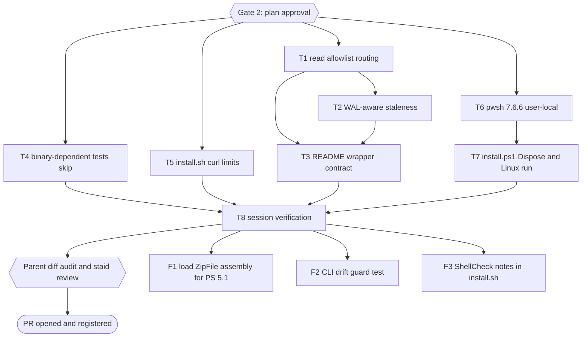

# Snipset CLI Stability Hardening Plan

> Frontmatter above is the single source of truth for routing, dependency order, retry, and idempotency. Prose below only explains and must never contradict it.

## 0. Session Checklist

Owned by the parent. An item is checked only together with its evidence (command, exit code, result).

- [x] Classify: Bounded path (three scoped changes to existing flows, several subagent-owned units). Evidence: classification stated in session 2026-10-12.
- [x] Explore: baseline and reproductions measured. Evidence: `bun test tests/` 42 pass / 0 fail with the binary; 24 pass / 18 fail with `snipset` removed from PATH; wrapper probe printed `deleted 1` while the live row count stayed 1; WAL probe read 1 snippet while live held 2.
- [x] Isolate: session claimed and worktree created beside the repo. Evidence: `pr-registry.mjs claim` exit 0 (`stability-hardening`, isolated); `git worktree add .../snipset-cli-wt/stability-hardening` at `53f477f`.
- [x] Register `snipset-cli` in vivera `plans.publish.json` and `plan.issues.json`. Both files are gitignored local configuration (`git check-ignore` hits `.gitignore:62` and `:63`), so this is a local edit, not a vivera PR; the vivera session claimed for it was closed unused. Evidence: `jq -e .` exit 0 on both files; `plan-publish.mjs --check <this plan>` now resolves the project and reports `MISSING` (exit 1) instead of "no project owns". Backups: `~/vivera/plans.publish.json.bak-20261012-snipset-cli`, `~/vivera/plan.issues.json.bak-20261012-snipset-cli`.
- [x] Validate this plan. Evidence: `bun ~/vivera/scripts/ultra-plan-runner.mjs <this plan>` printed `Validation: OK`, 8 tasks, exit 0.
- [x] Publish the 4 older `snipset-cli` plans so registration adds no drift. Evidence: 4 x `plan-publish.mjs <plan>` exit 0 into `01 - Projects/snipset-cli/plans/`; `--check --all` lists the same 38 failures with the pre-change config and the new one (all from other projects, 0 from `snipset-cli`), so registration added none. The 38 are recorded for the debt sweep.
- [x] Publish Draft mirror and sync the GitHub issue. Evidence: `plan-publish.mjs <this plan>` exit 0 (`[staged in vault]`); `plan-issue-sync.mjs <this plan>` exit 0, created `belajarcarabelajar/snipset-cli#3`; `plan-issue-sync.mjs --check` exit 0.
- [x] Gate 2: plan approved by the owner. Evidence: owner message "Yes, please implement this plan!" on 2026-10-12, recorded in section 12.
- [x] T1 read allowlist routing. Evidence (parent rerun): routing test against the original wrapper exit 1 (21 pass, 34 fail, every write case); with the change `bun test tests/snipset-live-routing.test.mjs tests/snipset-live.test.mjs tests/snipset-live-hardening.test.mjs` exit 0 (67 pass, 0 fail); shellcheck and `bash -n` exit 0. Commit `905fe66`.
- [x] T2 WAL-aware staleness. Evidence (parent rerun): snapshot test against the T1 wrapper exit 1 (2 pass, 1 fail: stale snapshot served); with the change the four wrapper suites exit 0 (70 pass, 0 fail); shellcheck and `bash -n` exit 0. Commit `affc65b`.
- [x] T3 README and opencode command wrapper contract. Evidence: em dash scan over both files exit 0; parent cross-checked the text against `scripts/snipset-live.sh:13`, `:43`, and the `case "$cmd $sub"` allowlist. Commit `3918e76`.
- [x] T4 binary-dependent tests skip with a reason. Evidence: original files without the binary 25 pass / 17 fail, stable over 4 runs (an earlier count of 18 used a different PATH order and did not reproduce); after the change, without the binary exit 0 (0 pass, 17 skip, one reason line printed), with the binary exit 0 (17 pass, 0 skip). Reason line added by the parent inline because bun test prints skipped names but not reasons. Commit `c057955`.
- [x] T5 install.sh curl retry and stall limits. Evidence (parent rerun): new test against the original `install.sh` exit 1; with the change `bun test tests/install.test.mjs` exit 0 (14 pass, 0 fail); `shellcheck -S warning install.sh` exit 0. Commit `f6596c8`.
- [x] T6 pwsh 7.6.6 user-local. Evidence: `gh release download v7.6.6 -R PowerShell/PowerShell` into `~/.cache/pwsh-download/v7.6.6.T2CzEg/`; size 75876271 and sha256 `ddbc4a2d...f103bc` equal the release API digest; 0 absolute, `..`, or symlink entries; extracted to `~/.local/opt/powershell/7.6.6`, linked `~/.local/bin/pwsh`; plan T6 command exit 0 (`7.6.6`). Telemetry: Microsoft about_Telemetry (updated 2026-05-27, read 2026-10-12) says startup telemetry is sent unless `POWERSHELL_TELEMETRY_OPTOUT` is set, so every plan command sets it.
- [x] T7 install.ps1 Dispose plus Linux run. Evidence (parent rerun, telemetry opted out): contract against the original `install.ps1` exit 1, with the change exit 0; `bun test tests/install-ps1.test.mjs` exit 0 (2 pass); the subagent also showed the test goes red when the temp cleanup, stage cleanup, or checksum throw is removed. Commit `d910b56`. Boundary: Linux cannot show the leaked handle itself.
- [x] T8 session verification. Evidence (fresh, after the review fixes): `bun test tests/` exit 0 (104 pass, 0 fail); PATH without `snipset` and `pwsh` exit 0 (84 pass, 20 skip, 0 fail, 2 reason lines); `shellcheck -S warning install.sh scripts/snipset-live.sh` exit 0; `bash -n` on both exit 0; `pwsh -NoProfile -File tests/install.Tests.ps1` exit 0; runner `--execute` exit 0 with an empty error ledger. Diff audit: 14 planned paths only; em dash and attribution scans 0. Independent review (`staid`): `correct`, one [P3] finding fixed in `bed3b6e` (contract check now runs in `bun test`; red without the `Dispose` line) and one observation fixed in `1feb6fa` (wrapper header comment). Report: `docs/code-plan/sessions/2026-10-12-snipset-cli-stability-hardening/review.md`.
- [x] Deliver. Evidence: 9 commits staged by explicit path under the repository owner identity, no co-author trailer; `git push -u origin <branch>` exit 0; `gh pr create --body-file docs/code-plan/sessions/2026-10-12-snipset-cli-stability-hardening/pr.md` exit 0, PR #4; `pr-registry.mjs pr stability-hardening --number 4` exit 0, state `open`; PR head `c2a9893`, `MERGEABLE`.
- [x] Debt sweep harvest and question. Evidence: 10 debts recorded in `docs/code-plan/sessions/2026-10-12-snipset-cli-stability-hardening/debt-sweep.md` (4 NOW, 6 LATER with `defer:`); learning ledger written, 5 KEEP rules in `MEMORY.md`; owner selected D1, D2, D3 on 2026-10-12. (+3 follow-up items below)
- [x] F1 load the ZipFile assembly before `OpenRead`. Evidence (parent): PowerShell 7 probe `Add-Type -AssemblyName System.IO.Compression.FileSystem` exit 0; with the line removed `bun test tests/install-ps1.test.mjs` exit 1 (2 pass, 1 fail), with it exit 0 (3 pass). Commit `ab99c80`. Windows PowerShell 5.1 runtime still unverified (D7).
- [x] F2 CLI drift guard. Evidence (parent): `bun test tests/snipset-live-cli-drift.test.mjs` exit 0 (10 pass); mutation `set-color` renamed in the table exit 1 naming `set-color`, restored byte-identical (`cmp`), exit 0; without the binary exit 0 (10 skip). Commit `524cd8a`.
- [x] F3 ShellCheck notes. Evidence (parent): `shellcheck install.sh` exit 1 before (SC1003 at 65:35, SC2016 at 128, 174, 176), exit 0 after; 0 non-comment lines changed; `bun test tests/install.test.mjs` exit 0 (14 pass). Commit `aa26e5d`.
- [x] Sweep close: plan closeout decision. Evidence: `bun ~/vivera/scripts/plan-closeout.mjs --readiness <this plan>` exit 3, verdict `NEEDS-HUMAN` (T1, T2, T4 to T7, F1 to F3 `DONE`; T3 and T8 `UNPROVEN` because their `skip_if` is the `false` sentinel; 0 open NOW follow-ups); runner `--execute` on the same state exit 0 with T3 and T8 `PASSED`; owner answered `Mark Complete` on 2026-10-12. The graph index and the final mirror and issue sync run after this commit and are recorded in `docs/code-plan/sessions/2026-10-12-snipset-cli-stability-hardening/debt-sweep.md`.

## 1. Intent & Scope

- **Goal:** Remove three measured stability defects in `snipset-cli` without adding features: wrapper writes that silently land on the snapshot, stale snapshot reads in WAL mode, and a test suite that fails on any host without the private `snipset` binary; plus harden both installers against stalled downloads and a leaked zip handle.
- **Architecture:** All changes stay inside the existing shell wrapper, the two installers, and the Bun test suite. The wrapper keeps its contract (reads hit the snapshot, writes are doctor-gated against the live file) and only corrects which commands count as reads and when the snapshot is stale.
- **Tech Stack:** Bash 5, Bun 1.4.3 (`bun test` running `node:test` files), PowerShell 7.6.6 on Linux for installer verification, ShellCheck.
- **Active Project Profile:** root `/home/belajarcarabelajar/Proyek/snipset-cli`, session worktree `/home/belajarcarabelajar/Proyek/snipset-cli-wt/stability-hardening`, branch `2026-10-12-snipset-cli-stability-hardening/stability-hardening`, base `origin/main` at `53f477f`. Configuration sources: `package.json` (`test: bun test tests/`), `.github/workflows/test.yml`, `README.md`. Installed CLI `snipset 0.2.0` at `~/.local/bin/snipset`.
- **Project Commands:** test `bun test tests/`; shell lint `shellcheck -S warning <file>`; syntax `bash -n <file>`; PowerShell contract `pwsh -NoProfile -File tests/install.Tests.ps1`. No build, typecheck, or package step exists in this repository.
- **Protected Boundaries:** the private Rust CLI binary and its schema are out of reach; the live Desktop database (`~/.local/share/Snipset/snipset.db`) is never opened by tests; `.github/workflows/` is not touched (owner decision 2026-10-12: CI is out of scope because of a billing limit).
- **Spec:** this plan; the design was agreed in chat on 2026-10-12 (no separate spec file, Bounded path).
- **Scope:** `scripts/snipset-live.sh`, `install.sh`, `install.ps1`, `tests/`, `README.md` wrapper section, a user-local PowerShell install on this host.
- **Non-Goals:** CI changes; new CLI commands or flags; changing the snapshot mechanism to an SQLite online backup; Windows runtime verification (still needs a Windows host); macOS or ARM targets.

## 2. Visual Map

## 3. Reasoning Lenses

| Lens | Output |
|---|---|
| Intent & Scope | Goal, non-goals, and acceptance criteria in sections 1 and 4. |
| Investigative & Evidence | Baseline 42/0 with binary, 24/18 without; two wrapper defects reproduced on a temporary database. |
| Computational | Read classification becomes an allowlist over up to three positional words; staleness compares the snapshot with both the database and its `-wal` file. |
| Critical & Adversarial | Option values placed before subcommands could shift positionals; the failure direction is a read treated as a write, which is the safe side (doctor-gated, never silent data loss). |
| Behavioral & Test-First | Every code task starts with a test that fails for the measured defect. |
| Security & Privacy | Snapshot stays owner-only (`umask 077`); no secrets in fixtures; the PowerShell tarball is checked against the release digest before extraction. |
| Reproducibility | Commands are runnable from the worktree; the without-binary run is expressed as a PATH override, not a machine path. |
| Epistemic & Provenance | PowerShell version, asset, and digest from the GitHub releases API; install method from Microsoft Learn (updated 2026-06-13, read 2026-10-12). |

## 4. Acceptance Criteria and Traceability

| AC | Observable condition | Task | Check | Evidence |
|---|---|---|---|---|
| AC-1 | Wrapper sends `clipboard delete/favorite/update/clear`, `clipboard tag add/remove/set-color`, `audio history delete/clear/save`, `audio dictionary add/remove/approve` to the doctor-gated live path; it refuses them with exit 3 when doctor fails. | T1 | `bun test tests/snipset-live-routing.test.mjs` | exit 0 after RED exit 1 |
| AC-2 | Wrapper keeps reads on the snapshot: `snippet list/get/search/expand`, `group list`, `stats *`, `reference list`, `clipboard list/get/search/export`, `clipboard tag list`, `audio history list/get`, `audio dictionary list`, `audio tts list`, `audio stats`. | T1 | same file | exit 0 |
| AC-3 | Snapshot refreshes when the live `-wal` file is newer than the snapshot even if the main database file is not. | T2 | `bun test tests/snipset-live-snapshot.test.mjs` | exit 0 after RED exit 1 |
| AC-4 | README states the exact read allowlist, the real default snapshot directory, and the WAL-aware staleness rule; no em dash. | T3 | em dash scan, diff review | exit 0 |
| AC-5 | Without `snipset` on PATH the suite exits 0 and reports the binary-dependent tests as skipped with a reason; with it, 0 skips among them and 0 failures. | T4 | PATH-override run and normal run | exit 0 both |
| AC-6 | Every `curl` call in `install.sh` carries `--retry 3`, `--connect-timeout 15`, `--speed-limit 1024`, `--speed-time 60`. | T5 | `bun test tests/install.test.mjs` | exit 0 after RED exit 1 |
| AC-7 | `install.ps1` disposes the archive opened for entry validation in a `finally` block; contract test enforces it; the installer runs end to end under PowerShell 7.6.6 on Linux against a local fixture server. | T6, T7 | `pwsh -NoProfile -File tests/install.Tests.ps1`, `bun test tests/install-ps1.test.mjs` | exit 0 after RED exit 1 |
| AC-8 | Whole suite, both PATH modes, ShellCheck, and `bash -n` are green with 0 warnings. | T8 | five commands in T8 | exit 0 each |

## 5. Tasks

### Task T1: Read allowlist routing

**Files:**
- Modify: `scripts/snipset-live.sh:48-73` (positional parsing and `is_read` case)
- Create: `tests/snipset-live-routing.test.mjs`
- Test: `tests/snipset-live.test.mjs`, `tests/snipset-live-hardening.test.mjs` (regression)

**Interfaces:**
- Consumes: wrapper CLI `snipset-live.sh [wrapper flags] [--] <snipset args>` and env `SNIPSET_LIVE_DB`, `SNIPSET_LIVE_SNAPSHOT_DIR`.
- Produces: unchanged CLI; the internal `is_read` decision now uses up to three positional words (`cmd`, `sub`, `action`).

**Preconditions:**
- [x] `bun --version` exits 0 (else `E_PRECOND_DEP`).
- [x] `scripts/snipset-live.sh` exists in the worktree (else `E_PRECOND_INPUT`).

**Idempotency Check:** skip when `bun test tests/snipset-live-routing.test.mjs` exits 0.

**Behavior & Acceptance:** AC-1, AC-2. Default for any command not on the allowlist stays the doctor-gated write path.

**Edge Cases & Failure Behavior:** `--json` and `--db`/`--db=` anywhere in argv; `--` separator; `clipboard` with no subcommand (write path, as today for unknown input); `stats` with any subcommand is a read because the CLI documents it as read-only.

**Deliberate Shortcuts & Deferrals:** `defer: options with values placed before subcommands are not parsed (none exist in snipset 0.2.0 besides --db), upgrade-trigger: a global option that takes a value is added to the CLI`.

**Dependencies & Risks:** misclassifying a write as a read is the harmful direction; the test matrix covers every write subcommand listed by `snipset <cmd> --help` on 2026-10-12.

**Review & Evidence:** stub `snipset` logs argv; tests assert which `--db` target each command received and that doctor ran first for writes.

**Reasoning Output:** allowlist over `(cmd, sub, action)`; everything else falls to the gated path.

**Test Data & Determinism:** temporary directory per test, stub binary on PATH, no real database, cleanup in `finally`.

- [x] Step 1: Write `tests/snipset-live-routing.test.mjs` with the read and write matrices from AC-1 and AC-2, reusing the stub pattern from `tests/snipset-live.test.mjs`.
- [x] Step 2: Run, verify fail | cmd: `bun test tests/snipset-live-routing.test.mjs` | expect: exit 1 | retry: 0 | on_fail: n/a
- [x] Step 3: Replace the `is_read` case in `scripts/snipset-live.sh` with the three-word allowlist.
- [x] Step 4: Run, verify pass | cmd: `bun test tests/snipset-live-routing.test.mjs tests/snipset-live.test.mjs tests/snipset-live-hardening.test.mjs` | expect: exit 0 | retry: 1 | on_fail: mark FAILED, halt T2 and T3 only
- [x] Step 5: Parent commits by explicit path.

### Task T2: WAL-aware snapshot staleness

**Files:**
- Modify: `scripts/snipset-live.sh:41-47` (refresh condition)
- Create: `tests/snipset-live-snapshot.test.mjs`
- Test: `tests/snipset-live.test.mjs` (regression)

**Interfaces:** Consumes the T1 version of the script. Produces an unchanged CLI.

**Preconditions:**
- [x] T1 integrated in the worktree (else `E_PRECOND_UPSTREAM`).

**Idempotency Check:** skip when `bun test tests/snipset-live-snapshot.test.mjs` exits 0.

**Behavior & Acceptance:** AC-3. Refresh when forced, when the snapshot is missing, when the live database is newer, or when the live `-wal` exists and is newer than the snapshot.

**Edge Cases & Failure Behavior:** `-wal` absent (no change from today); snapshot `-wal` removed when live has none (existing behavior kept); file timestamps set explicitly in tests with `utimes` so ordering is deterministic.

**Deliberate Shortcuts & Deferrals:** `defer: cp of database then -wal is not atomic and can produce a torn snapshot while the app writes, upgrade-trigger: a reproduced inconsistent snapshot or a report of corrupt reads`. Unmeasured; recorded in the backlog.

**Dependencies & Risks:** the existing reuse test expects no refresh when live is older; kept green.

**Review & Evidence:** test sets `live` mtime older than the snapshot and `live-wal` mtime newer, then asserts the snapshot content changed.

**Reasoning Output:** one extra `-nt` comparison; no new dependency.

**Test Data & Determinism:** plain files with fixed contents and explicit mtimes; no SQLite needed.

- [x] Step 1: Write the failing test.
- [x] Step 2: Run, verify fail | cmd: `bun test tests/snipset-live-snapshot.test.mjs` | expect: exit 1 | retry: 0 | on_fail: n/a
- [x] Step 3: Extend the refresh condition.
- [x] Step 4: Run, verify pass | cmd: `bun test tests/snipset-live-snapshot.test.mjs tests/snipset-live-routing.test.mjs tests/snipset-live.test.mjs tests/snipset-live-hardening.test.mjs` | expect: exit 0 | retry: 1 | on_fail: mark FAILED, halt T3 only
- [x] Step 5: Parent commits by explicit path.

### Task T3: README wrapper contract

**Files:**
- Modify: `README.md:74-83`, `.opencode/commands/snipset-live.md:6-9` (added 2026-10-12 during execution: the command doc repeats the same wrong read list and default directory, found by the T1 impact check)

**Interfaces:** documents the T1 allowlist and the T2 staleness rule.

**Preconditions:**
- [x] T1 and T2 integrated (else `E_PRECOND_UPSTREAM`).

**Idempotency Check:** `skip_if: "false"` (documentation, reviewed by diff).

**Behavior & Acceptance:** AC-4. Replace the read list with the AC-2 allowlist, correct the default snapshot directory to `${TMPDIR:-/tmp}/snipset-live-<uid>` (matches `scripts/snipset-live.sh:13`), and state that a newer `-wal` also triggers a refresh.

**Edge Cases & Failure Behavior:** none.

**Deliberate Shortcuts & Deferrals:** None.

**Dependencies & Risks:** documentation only; TDD exception class "documentation" applies.

**Review & Evidence:** em dash scan exit 0 and the parent reads the diff.

**Reasoning Output:** README matches code line for line.

**Test Data & Determinism:** N/A.

- [x] Step 1: Edit the section.
- [x] Step 2: Run | cmd: `bash -c '! rg -n --max-columns=0 "\x{2014}" README.md .opencode/commands/snipset-live.md'` | expect: exit 0 | retry: 0 | on_fail: remove the em dash
- [x] Step 3: Parent commits by explicit path.

### Task T4: Binary-dependent tests skip with a reason

**Files:**
- Create: `tests/snipset-bin.mjs` (exports the skip reason, `false` when `Bun.which("snipset")` finds the binary)
- Modify: `tests/dummy-db.test.mjs`, `tests/pentest-core.test.mjs`, `tests/pentest-aux.test.mjs` (pass `{ skip: snipsetSkip }` to every test that runs the real binary, including the wrapper test at `pentest-aux.test.mjs:168`)

**Interfaces:** Produces `export const snipsetSkip` (string reason or `false`).

**Preconditions:**
- [x] `bun --version` exits 0.

**Idempotency Check:** skip when the PATH-override run of `bun test tests/` exits 0.

**Behavior & Acceptance:** AC-5. Measured fact: Bun 1.4.3 honors `test(name, { skip: reason }, fn)` from `node:test` (probe 2026-10-12: 1 pass, 1 skip, exit 0).

**Edge Cases & Failure Behavior:** a binary present but broken still fails loudly (only absence skips); `tests/dummy-db.mjs` is a fixture and stays unchanged.

**Deliberate Shortcuts & Deferrals:** None.

**Dependencies & Risks:** a skip hides coverage on hosts without the binary; the reason string names the binary so the skip is visible in output.

**Review & Evidence:** both PATH modes run; the without-binary output shows skips, not failures.

**Reasoning Output:** one helper reused by three files.

**Test Data & Determinism:** unchanged fixtures.

- [x] Step 1: Observe RED | cmd: PATH-override run of the three files | expect: exit 1 | retry: 0 | on_fail: n/a
- [x] Step 2: Add the helper and the skip options.
- [x] Step 3: Run without binary | expect: exit 0 | retry: 0 | on_fail: mark FAILED-ISOLATED
- [x] Step 4: Run with binary | cmd: `bun test tests/dummy-db.test.mjs tests/pentest-core.test.mjs tests/pentest-aux.test.mjs` | expect: exit 0 | retry: 1 | on_fail: mark FAILED-ISOLATED
- [x] Step 5: Parent commits by explicit path.

### Task T5: install.sh curl retry and stall limits

**Files:**
- Modify: `install.sh:70,82,83` (the three `curl` calls), `tests/install.test.mjs` (stub logs argv; new test)

**Interfaces:** unchanged installer CLI. Internal: one `curl_opts` array shared by the three calls.

**Preconditions:**
- [x] `shellcheck --version` exits 0.

**Idempotency Check:** skip when `bun test tests/install.test.mjs -t 'curl calls carry retry and stall limits'` exits 0 (Bun exits 1 when the filter matches no test, measured 2026-10-12).

**Behavior & Acceptance:** AC-6. `--max-time` is deliberately not used: a whole-transfer cap would abort slow but healthy links; the stall limit (`--speed-limit 1024 --speed-time 60`) catches a hung transfer instead.

**Edge Cases & Failure Behavior:** the test stub treats unknown flags as positional and keeps the last positional as the URL, so flags must precede the URL; the stub is updated to log argv without changing that behavior.

**Deliberate Shortcuts & Deferrals:** `defer: --proto =https is not enforced because SNIPSET_RELEASE_BASE_URL is the test seam, upgrade-trigger: the base URL override is removed or restricted`.

**Dependencies & Risks:** curl 7.x supports all four flags; no new dependency.

**Review & Evidence:** test asserts every logged curl invocation contains the four limits.

**Reasoning Output:** a stalled download now fails within about 60 seconds per attempt instead of hanging.

**Test Data & Determinism:** existing fixture archive and checksums.

- [x] Step 1: Write the failing test.
- [x] Step 2: Run, verify fail | cmd: `bun test tests/install.test.mjs -t 'curl calls carry retry and stall limits'` | expect: exit 1 | retry: 0 | on_fail: n/a
- [x] Step 3: Add `curl_opts` and use it in the three calls.
- [x] Step 4: Run, verify pass | cmd: `bun test tests/install.test.mjs` | expect: exit 0 | retry: 1 | on_fail: mark FAILED-ISOLATED
- [x] Step 5: Run | cmd: `shellcheck -S warning install.sh` | expect: exit 0 | retry: 0
- [x] Step 6: Parent commits by explicit path.

### Task T6: PowerShell 7.6.6 user-local install

**Files:** none in the repository. Host paths: `~/.local/opt/powershell/7.6.6/`, symlink `~/.local/bin/pwsh`.

**Interfaces:** Produces `pwsh` on PATH for T7.

**Preconditions:**
- [x] `~/.local/bin` is on PATH (`command -v snipset` resolves there).
- [x] At least 300 MB free on `/home` (`df -h ~`); the tarball is not downloaded to `/tmp` (tmpfs).

**Idempotency Check:** skip when `pwsh` reports version 7.6.6.

**Behavior & Acceptance:** AC-7 precondition. Steps run by the parent, inline, because this writes outside the worktree:
1. Download `https://github.com/PowerShell/PowerShell/releases/download/v7.6.6/powershell-7.6.6-linux-x64.tar.gz` into a new empty directory under `~/.cache/pwsh-download/`.
2. `sha256sum` must equal `ddbc4a2d113bbd46d283cfedcbcd117a70caefd7673f41f2b4e0000badf103bc` (GitHub releases API `digest`, read 2026-10-12). Mismatch stops the task.
3. Extract into `~/.local/opt/powershell/7.6.6/`, `chmod +x pwsh`, link `~/.local/bin/pwsh`.

**Edge Cases & Failure Behavior:** a missing native dependency (ICU, OpenSSL) shows as a start-up error; stop and report rather than installing system packages without approval.

**Deliberate Shortcuts & Deferrals:** None.

**Dependencies & Risks:** unofficial platform for Microsoft (Arch); Microsoft Learn documents this archive method for such distributions.

**Review & Evidence:** checksum line and version output in the session log.

**Reasoning Output:** reversible: `rm ~/.local/bin/pwsh` and `rm -r ~/.local/opt/powershell/7.6.6 ~/.cache/pwsh-download/v7.6.6.T2CzEg` (run by the user; agent `rm` is denied on this host). Downloaded with `gh release download` because the context-mode hook redirects `curl` in Bash.

**Test Data & Determinism:** pinned version and digest.

- [x] Step 1: Download and verify the checksum.
- [x] Step 2: Extract and link.
- [x] Step 3: Run | cmd: version check | expect: exit 0 | retry: 0 | on_fail: mark FAILED-BLOCKING for T7

### Task T7: install.ps1 Dispose and Linux run

**Files:**
- Modify: `install.ps1:32-35`, `tests/install.Tests.ps1` (add `Dispose` to the contract list)
- Create: `tests/install-ps1.test.mjs` (skips with a reason when `pwsh` is absent)

**Interfaces:** unchanged installer parameters `-Version`, `-InstallDir`, `-AddPath`, env `SNIPSET_RELEASE_BASE_URL`.

**Preconditions:**
- [x] T6 done: `pwsh` 7.6.6 on PATH (else `E_PRECOND_UPSTREAM`).

**Idempotency Check:** skip when `bun test tests/install-ps1.test.mjs` exits 0.

**Behavior & Acceptance:** AC-7. The archive opened by `[IO.Compression.ZipFile]::OpenRead` is held in a variable and disposed in `finally`. `tests/install-ps1.test.mjs` starts a `Bun.serve` fixture on `127.0.0.1` serving `SHA256SUMS` and a zip holding `snipset.exe` (built with `Compress-Archive` through `pwsh`), runs `pwsh -NoProfile -File install.ps1 -Version v0.1.0 -InstallDir <tmp>`, and asserts the binary is installed and no `snipset-install-*` or `.snipset-stage-*` directory is left behind. A second case serves a bad checksum and expects a non-zero exit with `checksum mismatch`.

**Edge Cases & Failure Behavior:** Linux does not lock open files, so the Linux run cannot go red for the leaked handle itself; the RED for the handle fix is the contract test in `tests/install.Tests.ps1` (text contract, same convention as the existing entries). This boundary is stated in the PR.

**Deliberate Shortcuts & Deferrals:** `defer: no Windows runtime check of the handle release, upgrade-trigger: next Windows verification session (docs/verification/HANDOFF-windows-install.ps1.md)`.

**Dependencies & Risks:** `[Net.ServicePointManager]` and `$env:LOCALAPPDATA` behave differently on Linux; the test passes `-InstallDir` so the Windows default is never evaluated.

**Review & Evidence:** both commands exit 0 after the RED.

**Reasoning Output:** turns an untested installer into one with an executable test on this host.

**Test Data & Determinism:** ephemeral port, temporary directories, server stopped in `finally`.

- [x] Step 1: Add `Dispose` to the contract list.
- [x] Step 2: Run, verify fail | cmd: `pwsh -NoProfile -File tests/install.Tests.ps1` | expect: exit 1 | retry: 0 | on_fail: n/a
- [x] Step 3: Wrap entry validation in `try { } finally { $zipArchive.Dispose() }`.
- [x] Step 4: Run | cmd: `pwsh -NoProfile -File tests/install.Tests.ps1` | expect: exit 0 | retry: 0
- [x] Step 5: Write `tests/install-ps1.test.mjs` and run | cmd: `bun test tests/install-ps1.test.mjs` | expect: exit 0 | retry: 1 | on_fail: mark FAILED-ISOLATED
- [x] Step 6: Parent commits by explicit path.

### Task T8: Session verification

**Files:** none modified.

**Preconditions:** T3, T4, T5, T7 integrated.

**Idempotency Check:** `skip_if: "false"`.

**Behavior & Acceptance:** AC-8, then the parent diff audit (`git diff --stat origin/main`, only planned paths), an independent review by `staid` on the diff, and the em dash and attribution scans over the diff and commit messages.

- [x] Step 1 to 5: the five commands in frontmatter, each exit 0.
- [x] Step 6: diff audit and review report saved as `docs/code-plan/reviews/2026-10-12-snipset-cli-stability-hardening-review.md`.

### Task F1: Load the ZipFile assembly before OpenRead

**Files:** Modify `install.ps1:32` area and `tests/install.Tests.ps1` (contract list). Test: `tests/install-ps1.test.mjs` (regression under PowerShell 7).

**Behavior & Acceptance:** AC-F1. `install.ps1` runs `Add-Type -AssemblyName System.IO.Compression.FileSystem` before `[IO.Compression.ZipFile]::OpenRead`. On .NET Framework, which Windows PowerShell 5.1 uses, `ZipFile` lives in `System.IO.Compression.FileSystem.dll` (Microsoft .NET API reference for `ZipFile`, read 2026-10-12); whether 5.1 loads it by default is not verified here. The contract test gains the exact `Add-Type` line, so removing it turns `bun test` red.

**Deliberate Shortcuts & Deferrals:** `defer: no Windows PowerShell 5.1 run, next Windows verification session`.

- [x] Step 1: Add the contract entry; run `env POWERSHELL_TELEMETRY_OPTOUT=1 pwsh -NoProfile -File tests/install.Tests.ps1`, expect exit 1.
- [x] Step 2: Add the `Add-Type` line; the same command exits 0; `bun test tests/install-ps1.test.mjs` exits 0.
- [x] Step 3: Parent commits by explicit path.

### Task F2: CLI drift guard test

**Files:** Create `tests/snipset-live-cli-drift.test.mjs`.

**Behavior & Acceptance:** AC-F2. For each command group the wrapper classifies (`snippet`, `group`, `stats`, `reference`, `clipboard`, `clipboard tag`, `audio`, `audio history`, `audio dictionary`, `audio tts`), the test reads the `Commands:` section of `snipset <group> --help` and fails when a listed subcommand is in neither its read nor its write table. It skips with the existing `snipsetSkip` reason when the binary is absent. `--help` is read-only and never opens a database.

**Deliberate Shortcuts & Deferrals:** None.

- [x] Step 1: Write the test with the tables taken from `snipset 0.2.0 --help`; run it, expect exit 0.
- [x] Step 2: Mutation check: remove one known subcommand from a table, expect exit 1, restore.
- [x] Step 3: Parent commits by explicit path.

### Task F3: ShellCheck notes in install.sh

**Files:** Modify `install.sh` (directive comments only). Test: `tests/install.test.mjs` (regression).

**Behavior & Acceptance:** AC-F3. Each of the 4 pre-existing notes gets a targeted `# shellcheck disable=` line stating why: SC1003 on the `case` pattern that matches a literal backslash, SC2016 on the literal `$PATH` written into `.bashrc`, and SC2016 twice on the literal `"$schema"` JSON key written into `opencode.json`. (Corrected after execution; the first draft attributed SC1003 to the error message and all three SC2016 notes to `$PATH`.) `shellcheck install.sh` at default severity exits 0. No executable line changes.

**Deliberate Shortcuts & Deferrals:** None.

- [x] Step 1: Run `shellcheck install.sh`, expect exit 1 (4 notes).
- [x] Step 2: Add the directives; `shellcheck install.sh` exits 0; `bun test tests/install.test.mjs` exits 0.
- [x] Step 3: Parent commits by explicit path.

## 6. Execution Handoff

Wave 1 (parallel, disjoint files): T1 to `chef`, T4 to `nappy`, T5 to `hoggy`; T6 inline by the parent (writes outside the worktree, needs the download and checksum in the parent's own log). Wave 2: T2 to `chef` after T1 is integrated (same file, same owner), T7 to `nappy` after T6. Wave 3: T3 to `hoggy`. Review: `staid`. Fan-out stays at 6 implementation chunks, below the floor of 10, because the work splits into exactly these disjoint file sets and T1/T2 share one file. Subagents never run git; the parent stages by explicit path.

## 7. Assumptions & Open Questions

- [stated] CI is out of scope (owner, 2026-10-12, billing limit).
- [stated] Register `snipset-cli` in vivera publish and issue configuration (owner, 2026-10-12).
- [stated] PowerShell is installed user-local from the official tarball (owner, 2026-10-12).
- Commits use `git -c user.name="Iwan Kurniawan" -c user.email="110369962+belajarcarabelajar@users.noreply.github.com"` because the repository has no configured identity; this matches the author of `53f477f~1`. No co-author trailer.

## 8. Dependencies & Impact

Consumers: users running `scripts/snipset-live.sh` (behavior change only for commands that were wrongly treated as reads, which now require doctor to pass); users of both installers (no interface change); the opencode command `.opencode/commands/snipset-live.md` (checked in T1 impacts). No other repository consumes these files.

## 9. Risks & Rollback

Rollback is `git revert` of the merge commit. PowerShell rollback is in Task T6. The vivera registration rolls back with `cp -p ~/vivera/plans.publish.json.bak-20261012-snipset-cli ~/vivera/plans.publish.json` and `cp -p ~/vivera/plan.issues.json.bak-20261012-snipset-cli ~/vivera/plan.issues.json`.

## 10. Security, Compatibility, Operations

Security: no credential handling changes; tarball verified by digest; snapshot permissions unchanged. Compatibility: wrapper CLI and installer parameters unchanged. Operations: no deploy; release assets untouched.

## 11. Verification and Definition of Done

All AC rows have evidence; T8 commands exit 0 with 0 failures and 0 warnings; parent diff audit shows only planned paths; review has no P0/P1 finding; PR opened with the body file and registered; debt sweep complete.

## 12. Approval

- Gate 2 (plan): Approved by the owner on 2026-10-12 ("Yes, please implement this plan!"), after the plan summary, task table, and Mermaid map were shown in chat. Runner state at approval: `Validation: OK`, 8 tasks.
- Closeout (`Close plan` gate): `Mark Complete`, chosen by the owner on 2026-10-12 on the readiness verdict `NEEDS-HUMAN` (exit 3). The two `UNPROVEN` tasks, T3 (docs) and T8 (session verification), carry the `false` sentinel by design and `PASSED` in the final runner run.

## 13. Follow-up Backlog

- `defer: cp of database then -wal is not atomic, upgrade-trigger: a reproduced inconsistent snapshot` (from T2).
- `defer: no Windows runtime check of the handle release, upgrade-trigger: next Windows verification session` (from T7).
- `defer: CI test job red on every run (missing private binary), upgrade-trigger: CI billing restored` (owner decision 2026-10-12; T4 also removes the failure mode).
- `defer: refresh cost with Snipset Desktop running is unmeasured, upgrade-trigger: the owner reports slow wrapper reads or runs Desktop during a session` (D5).
- `defer: the read allowlist exists in three copies (scripts/snipset-live.sh, tests/snipset-live-routing.test.mjs, tests/snipset-live-cli-drift.test.mjs) with nothing comparing them, upgrade-trigger: an allowlist change that updates one copy and not the others` (D11, found by the sweep re-pass).
- `defer: vivera scripts/check-copy-rules.mjs scans vivera's own root when run for another repository, upgrade-trigger: next vivera session touching check-copy-rules` (D9).
- `defer: 38 vault mirrors missing or stale in Snipset, bcb, dawnbook, vivera, upgrade-trigger: their next session or a vault-wide publish run` (D10).
