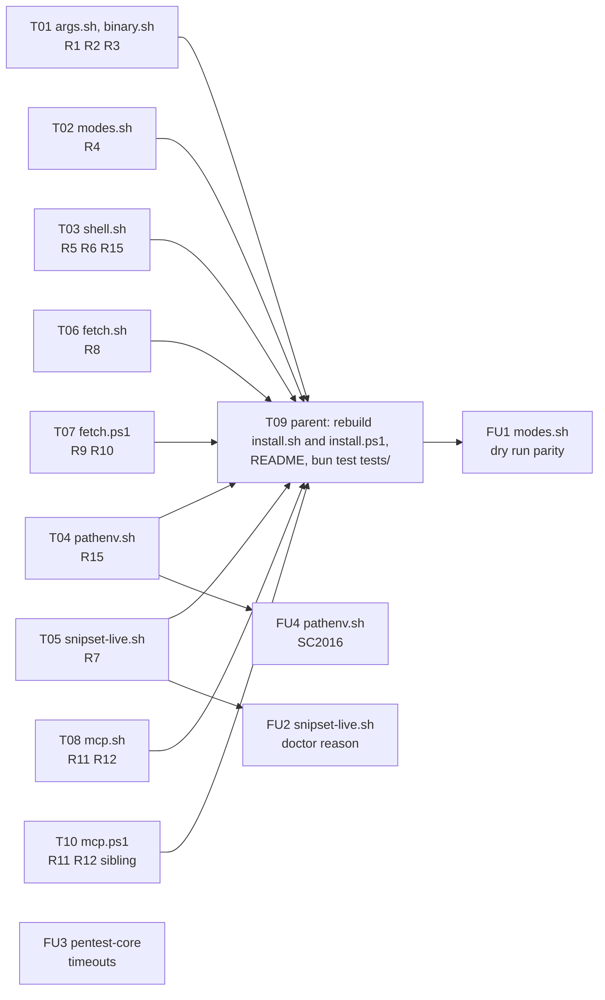

# Snipset CLI v0.2.0 release bug hunt

Find errors and bugs in the Snipset CLI distribution as shipped in the latest release (`v0.2.0`, Draft, published assets dated 2026-10-06), reproduce each one with a deterministic failing command, diagnose its root cause, and patch the ones approved at the RCA gate.

Path: Bounded, upgraded to Architectural if a confirmed root cause crosses into the upstream CLI crate (`~/Proyek/Snipset/crates/snipset-cli`), which is a separate repository and a separate session.

## Session checklist

- [x] Profile: active project profile recorded in this plan. Evidence: table below, built from `git worktree list`, `gh release view v0.2.0`, `sha256sum`, `command -v`.
- [x] Baseline: `bun test tests/` on `origin/main` (8cd3341) run with its exit code recorded. Evidence: exit 0, 590 pass, 6 skip, 0 fail, 596 tests across 40 files in 210.13 s. Skips: real-asset install (needs `SNIPSET_REAL_ASSETS`), nix flake check, `ruby -c`.
- [x] Release artifacts: v0.2.0 tarball, zip, and `SHA256SUMS` downloaded and verified against the release digests. Evidence: `gh release download v0.2.0` then `sha256sum -c SHA256SUMS`, both archives `OK`, digests equal the release API digests.
- [x] Manifest: discovery batch manifest written below before dispatch. Evidence: section "Discovery batch manifest", 14 chunks, written before the batch was dispatched.
- [x] Real assets: `tests/install-real-assets.test.mjs` run with `SNIPSET_REAL_ASSETS` pointing at the verified v0.2.0 assets (skipped in the baseline). Evidence: `SNIPSET_REAL_ASSETS=~/.cache/parent-v020 bun test tests/install-real-assets.test.mjs`, exit 0, 4 pass, 0 fail, 23.64 s.
- [x] Discovery: every chunk in the manifest returned a report (confirmed, disproven, or inconclusive with evidence). Evidence: 14 reports plus H15 (added after H10 found the bridge path); 13 confirmed bug, H09 disproven. H04, H08, H10, H11, H14 hit their turn limit and were continued once with a wrap-up message.
- [x] Synthesis: findings deduped, and every surviving finding re-run by the parent with its exit code recorded. Evidence: H05-a merged into H03-a, H13-a into H03-c; 37 unique defects (15 in this repository, 22 upstream); root-cause lines read by the parent.
- [x] Feedback loops: one red-capable command per confirmed bug, run once by the parent, output shown. Evidence: `bash ~/.cache/parent-verify.sh`, 43 of 43 non-zero (41 exit 1, 2 exit 3), each log tail shows the reported symptom.
- [x] RCA log: `docs/code-plan/sessions/2026-10-15-snipset-cli-release-bug-hunt/debugging-log.md` written from the template, Mermaid loop with accTitle and accDescr. Evidence: file written, sections 1 to 5.
- [x] Progress log: `docs/code-plan/sessions/2026-10-15-snipset-cli-release-bug-hunt/progress-log.md` written from the template. Evidence: file written.
- [x] Publish: `plan-publish.mjs` then `plan-issue-sync.mjs` run, exit codes recorded. Evidence: publish exit 0 (`source_hash d8cec40b6817`), issue sync exit 0, created belajarcarabelajar/snipset-cli#9.
- [x] RCA gate: `Root cause` question asked and answered. Evidence: 2026-10-15 answers recorded in "Approval" below.
- [x] T01 to T08: eight fix chunks dispatched, each with a RED test before its fix, gathered, and passed through the parent diff audit. Evidence: RED then GREEN per chunk against a private HEAD-plus-part bundle (T01 0/8 then 8/8, T02 1/4 then 4/4, T03 RED a/b/c then 7/7, T04 1/2 then 2/2, T05 9/39 then 39/39, T06 0/5 then 5/5, T07 0/2 then 2/2, T08 1/4 then 4/4); parent read `git diff` of each part, only permitted paths changed. T05 took option B (bare groups stay gated); T08's snipset-dev case reports `exists without snipset` (plan text amended).
- [x] T10: `install.ps1` MCP probe and opencode/vscode path parity with T08 (found by T08, sibling installer rule in MEMORY.md). Evidence: RED 1/6 then GREEN 6/6; neighbour ps1 suites 61 pass 0 fail; parent diff audit of `mcp.ps1`.
- [x] T09: parent rebuilds `install.sh` and `install.ps1`, updates README, `build.mjs --check` exit 0. Evidence: `bun scripts/installer/build.mjs` then `--check` exit 0; README updated (`--db` row, exit code 2 row, relative-path rule, opencode XDG path twice, snipset-live read list); the pinned hash of the README companion section in `tests/readme-install.test.mjs` updated for the deliberate R7 wording change.
- [x] Repro re-run: the 19 repo-side repro commands (R1 to R12, R15) go green, R13 and R14 stay as documented behaviour. Evidence: `bash ~/.cache/parent-verify-fixed.sh`: 21 of 22 commands exit 0 (H02-a and H12-a each in two variants); H04-a exits 1 only on its harness line that requires a `snipset` entry the installer by contract never writes into an existing cursor file, and both defect signatures (`already registered`, `[OK] cursor`) are absent (`rg -c` rc=1); X-H01-b and X-H04-c (R14, R13) stay red as approved.
- [x] Regression: `bun test tests/` 0 failures, real-asset suite green, shellcheck clean on the changed parts. Evidence: `bun test tests/` exit 0, 693 pass, 6 skip, 0 fail, 699 tests across 49 files, 162.09 s; real-asset suite exit 0, 4 pass; shellcheck exit 0 on every changed part except `pathenv.sh`, whose one SC2016 info is pre-existing at HEAD (also exit 1 there).
- [x] Verification fan-out: independent re-run, sibling-caller audit, two-axis diff review (`staid`), findings resolved. Evidence: `docs/code-plan/sessions/2026-10-15-snipset-cli-release-bug-hunt/review-report.md`; spec P1 (nested object) and standards P2 (stale export), P3 (v0.2.0 opencode path), P3 (README) fixed with RED then GREEN; final `bun test tests/` exit 0, 702 pass, 0 fail; `build.mjs --check` exit 0.
- [x] Deliver: commit by explicit path on the session branch, `state verified`, PR opened with `--body-file`, registered. Evidence: commits 27dd315, 53c8a06, and the PR body commit staged by explicit path; `pr-registry state verified`; `gh pr create --body-file` gave #10; `pr-registry pr release-bug-hunt --number 10` shows `open #10`.
- [x] Sweep: session-close debt sweep, learning ledger, MEMORY.md, follow-up question. Evidence: `follow-ups.md` (15 debts, 5 offered), `learning-ledger.md` (4 KEEP rules), MEMORY.md task group added, `AskUserQuestion` answered: all five selected.
- [x] FU1: dry run `--from` parity and the shell block line (D2, D4). Evidence: `tests/install-dryrun-followups.test.mjs` RED 2/6 then GREEN 6/6; neighbour suites 42 pass 0 fail; parent diff audit of `modes.sh` and the `install-cli` fixture.
- [x] FU2: live wrapper prints doctor's reason on a refused write (D3). Evidence: `tests/snipset-live-doctor-message.test.mjs` RED 1/2 then GREEN 2/2; `tests/snipset-live*.test.mjs` 147 pass 0 fail; README line and its pinned section hash updated, `readme-install` 24 pass.
- [x] FU3: explicit timeout for the CLI-spawning pentest-core tests (D1). Evidence: 60000 ms per test, 15000 ms per child; `bun test tests/pentest-core.test.mjs` 9/9 twice idle and twice under six `yes` loads (load average 9.5 to 10.5).
- [x] FU4: pathenv.sh SC2016 disabled with its reason (D5). Evidence: `shellcheck -s bash scripts/installer/sh/*.sh scripts/snipset-live.sh` exit 0.
- [x] Closeout: runner log, `plan-mark-done`, `plan-closeout --readiness`, `Close plan` gate. Evidence (2026-10-15): `bun ~/vivera/scripts/ultra-plan-runner.mjs <plan> --execute` from the repository root exit 0, 14 of 14 tasks `SKIPPED-IDEMPOTENT (skip_if exit 0)`, Error Ledger empty; `plan-mark-done --from runner.log` 14 considered, 0 open step lines; `plan-closeout.mjs --readiness` exit 0, `readiness: READY`, 14 DONE, open NOW follow-ups 0, open step boxes 0; `Close plan` answered Mark Complete.
- [x] Graph index: `graphify update .` then `bun run graphify:sync` and `graphify:check`. Evidence (worktree, `graphify-out/` gitignored): `graphify update .` exit 0; `graphify-sync.mjs --root "$(pwd)"` dry run 42 eligible docs, nodes 1461 -> 1839, then write exit 0; `--check` exit 0 CURRENT 1839 -> 1839; `graphify query` returns 30 lines naming this session's documents.

## Visual implementation map

## Approval

2026-10-15, through the question tool:

- `Root cause`: Approve the fix. Scope: F1 to F9 (R1 to R12, R15) in this repository, test first.
- `Contract`: Keep current behaviour for R13 and R14. Backlog: `defer: owner contract call, a user report of --check drift after --no-init or a --db change`.
- `Upstream`: Separate Snipset session for U1 to U22 in `~/Proyek/Snipset`, followed by a new release that this repository's manifests pin.

## Active project profile

| Field | Value | Source |
| --- | --- | --- |
| Repository root | `/home/belajarcarabelajar/Proyek/snipset-cli` | `git rev-parse` |
| Session worktree | `/home/belajarcarabelajar/Proyek/snipset-cli-wt/release-bug-hunt` | `pr-registry.mjs claim` |
| Session branch | `2026-10-15-snipset-cli-release-bug-hunt/release-bug-hunt` from `origin/main` 8cd3341 | `pr-registry.mjs claim` |
| Stack | bash installer (`scripts/installer/sh/*` bundled into `install.sh`), PowerShell installer (`scripts/installer/ps1/*` bundled into `install.ps1`), `scripts/snipset-live.sh`, package manifests rendered by `scripts/packaging/render.mjs` | repository tree |
| Runtime | Bun (`package.json` engines `>=1`, CI pins 1.4.3) | `package.json`, PR #2 |
| Test command | `bun test tests/` | `package.json` scripts |
| Bundle check | `bun scripts/installer/build.mjs --check --target sh` (and `--target ps1`) | prior plan |
| Release under test | `v0.2.0` Draft. Linux tarball sha256 `57b43b6e...cfe5`, Windows zip sha256 `90d888f7...edcc` | `gh release view v0.2.0` |
| Release binary | `~/.cache/parent-v020/x/snipset`, reports `snipset 0.2.0` | extracted from the verified tarball |
| Installed binary | `~/.local/bin/snipset` reports `0.2.0` but its sha256 (`b59ac735...`) differs from the release binary (`c2205926...`), so it is a local build and is not the release under test | `sha256sum` |
| CLI source | `~/Proyek/Snipset/crates/snipset-cli` (private, crate version 0.2.0); one CLI commit after the release date: `519b1f797` (2026-10-14) | `git log` |
| Protected paths | live database `~/.local/share/Snipset/snipset.db` (read only through `sqlite3 .backup` copies), the real `$HOME` startup files and harness configs | MEMORY.md, prior sessions |
| Tools present | pwsh, shellcheck, sqlite3, jq, fish, makepkg. Absent: zsh, brew, nix, Windows | `command -v` |

## Discovery batch manifest

No user-reported symptom exists, so Phase 0 runs per finding: every chunk must hand back a red-capable command (exit non-zero on the bug, deterministic, seconds, no human) for each bug it claims, and the parent re-runs it before the finding is accepted. Chunks are read-only on the repository; scratch lives in `~/.cache/h<NN>-*`. No chunk writes a repository file, so write scopes cannot overlap.

| Chunk | Hypothesis under test | Scope (read/run) | Owner | Expected output | Verification |
| --- | --- | --- | --- | --- | --- |
| H01 | A clean `install.sh --from` of the real v0.2.0 assets in a temp HOME completes every step (binary, init, shell bundle, shims) and an immediate `--check` reports `check: CURRENT` | `install.sh`, `scripts/installer/sh/{binary,db,shell,shims,modes}.sh` | bold | verdict per step + repro | parent re-runs repro |
| H02 | install, re-install, `--update --from`, `--uninstall` leave no residue and delete no user file | `scripts/installer/sh/{modes,lib}.sh` | timid | verdict + repro | parent re-runs repro |
| H03 | argument parsing rejects or accepts edge inputs correctly (`--version 0.2.0` without `v`, `--x=` forms, empty values, paths with spaces, relative `--from`) | `scripts/installer/sh/args.sh` | aqua | verdict + repro | parent re-runs repro |
| H04 | `--with-mcp` writes valid, merged, idempotent configs for each harness and uninstall removes only its entry | `scripts/installer/sh/mcp.sh` | timid | verdict + repro | parent re-runs repro |
| H05 | `--add-path` and the bashrc block are idempotent and correct for bash and fish, custom `--bashrc` included | `scripts/installer/sh/{pathenv,shell}.sh` | aqua | verdict + repro | parent re-runs repro |
| H06 | the release shell bundle (`shell/*.sh`, `completion.bash`) works with the release binary in interactive bash | release tarball `shell/`, `scripts/installer/sh/shims.sh` | bold | verdict + repro | parent re-runs repro |
| H07 | `scripts/snipset-live.sh` read/write routing matches the release CLI command tree | `scripts/snipset-live.sh`, `tests/snipset-live-*.test.mjs` | timid | verdict + repro | parent re-runs repro |
| H08 | `install.ps1` works under pwsh against the real v0.2.0 zip (dry run, install, check, uninstall) | `install.ps1`, `scripts/installer/ps1/*` | aqua | verdict + repro | parent re-runs repro |
| H09 | every package manifest (Homebrew, Scoop, AUR, winget, Nix) matches the v0.2.0 release (URL, version, sha256) and `render.mjs` reports no drift | `packaging/`, `Formula/`, `bucket/`, `flake.nix`, `scripts/packaging/render.mjs` | timid | verdict + repro | parent re-runs repro |
| H10 | the release binary's DB-only commands (snippet, group, import, export, settings, reference, support list, stats, doctor, init) behave and exit correctly on a fresh and a copied database | release binary | bold | verdict + repro | parent re-runs repro |
| H11 | the release binary's MCP stdio server answers initialize, tools/list, and DB-only tool calls correctly | release binary `mcp` | aqua | verdict + repro | parent re-runs repro |
| H12 | release resolution and download work: default latest when only a Draft exists, curl and wget paths, checksum tool fallbacks | `scripts/installer/sh/{fetch,platform}.sh`, `scripts/installer/ps1/fetch.ps1` | timid | verdict + repro | parent re-runs repro |
| H13 | README and `--help` text match the real flags and behaviour, and the committed bundles match their parts | `README.md`, `install.sh --help`, `install.ps1` help, `scripts/installer/build.mjs` | aqua | verdict + repro | parent re-runs repro |
| H14 | the release binary's note, task, journal, clipboard, audio, and pomodoro read paths work on a temp and a copied database with valid `--json`, without contacting the running app for writes | release binary | bold | verdict + repro | parent re-runs repro |

Chunk boundary check: 14 chunks, one owner each, every installer part, the live wrapper, the manifests, the docs, and the release binary are covered; no chunk writes a repository file.

## Findings

Full RCA: `docs/code-plan/sessions/2026-10-15-snipset-cli-release-bug-hunt/debugging-log.md`. Summary:

- This repository, 15 defects. P1: R1 relative paths written verbatim into startup files and MCP configs; R6 shims installed with `--db` cannot find that database. P2: R2 empty flag values pass parsing; R5 `--bashrc` in a missing directory aborts the install halfway; R8 failed latest lookup or download exits with the downloader's code and no message. P3: R3, R4, R7, R9 to R15.
- Upstream payload (`~/Proyek/Snipset`), 22 defects, none fixed at HEAD `ef61ef01c`. P1: U1 writes ignore `--db` when the control API answers; U2 JSON export then import drops group and settings; U3 `audio dictionary list` fails on every app-created database. These need a separate session and a new release.
- Package manifests: no defect (H09 disproven).

Proposed fixes F1 to F9 are listed in section 4 of the debugging log. R13 and R14 are contract questions for the owner.

## Tasks

Every chunk tests against a private bundle (HEAD parts plus its own part, built with `bun scripts/installer/build.mjs --root <tmp> --out <tmp>` and passed through `SNIPSET_INSTALL_SCRIPT` or `SNIPSET_INSTALL_PS1`), never against the shared `install.sh`. The parent regenerates the committed bundles in T09. Each new test file defaults to the repository bundle when the variable is unset, so it runs in the suite after T09.

### Task T01: argument shape (R1, R2, R3)
**Files:** Modify `scripts/installer/sh/args.sh`, `scripts/installer/sh/binary.sh`; Create `tests/install-args-shape.test.mjs`.
**Behaviour:** after the parse loop, for `--install-dir`, `--share-dir`, `--db`, `--bashrc`, `--from`: an empty value or a value starting with `-` is a usage error (exit 2, nothing written); a relative value becomes absolute against `$PWD` (a leading `~` is not expanded by the installer; it is relative like any other). The special-character check runs on the absolute value. `binary.sh` calls `mktemp` with `--` or an absolute template so a value can never be read as an option.
**Tests (names start `args shape:`):** relative `--install-dir rbin --share-dir rshare --add-path --db data/x.db` from a cwd inside the sandbox writes only absolute paths into `.bashrc`, `.profile`, `<share>/env`, and `opencode.json`, and a login shell started from `/` finds `snipset`; `--share-dir ''`, `--bashrc ''`, `--install-dir ''`, `--db ''` exit 2 with no file written in HOME; `--db --dry-run` exits 2 and writes nothing.
**Evidence:** RED on HEAD (relative path written, exit 1 or 0 with files written), GREEN after the change, `tests/install-cli.test.mjs` still green.

### Task T02: dry run validates the version (R4)
**Files:** Modify `scripts/installer/sh/modes.sh`; Create `tests/install-dryrun-validate.test.mjs`.
**Behaviour:** `install_dry_run` validates and normalises a pinned `--version` with the same rule as the real run (exit 2 `invalid version`, `0.2.0` shown as `v0.2.0`), without any network or write. `--from` that does not exist is reported the same way the real run reports it.
**Tests (names start `dry run validate:`):** `--dry-run --version garbage` exits 2 and prints `invalid version`; `--dry-run --version 0.2.0 --from <assets>` prints `v0.2.0`; `--dry-run --from /nonexistent` exits non-zero like the real run; a valid dry run still writes nothing.

### Task T03: shell block fixes (R5, R6, R15 for the block)
**Files:** Modify `scripts/installer/sh/shell.sh`; Create `tests/install-shell-fixes.test.mjs`.
**Behaviour:** (a) `shell_block_add` creates the parent directory of `--bashrc` through `mkdir_recorded` before `touch_recorded`, so `--bashrc` in a missing directory works without `--add-path` and uninstall removes the directory it created. (b) When `--db` is given, the block exports `SNIPSET_DB` with that path, so shims, TAB, and completion use it; `--check` reports a block that lacks or differs in that line as drift, a re-install brings an older block (written by the v0.2.0 installer, no export line) to the current shape, and uninstall removes both shapes. Without `--db` the block is byte-identical to today's. (c) A pre-existing rc file whose last byte is not a newline is byte-identical after install plus uninstall.
**Tests (names start `shell fixes:`):** (a) `--bashrc $HOME/.config/bash/bashrc` without `--add-path` exits 0, `--check` says CURRENT, the database exists; (b) install with `--db` from the real-format fixture with one snippet, then a fresh `bash -ic` runs the shim and prints the expansion; an older block is upgraded and then removed by uninstall; (c) `.bashrc` ending `alias ll=ls` with no newline is byte-identical after install and uninstall.

### Task T04: PATH line keeps a missing final newline (R15 for PATH lines)
**Files:** Modify `scripts/installer/sh/pathenv.sh`; Create `tests/install-pathenv-eol.test.mjs`.
**Behaviour:** a pre-existing `.profile`, `.bash_profile`, or `.zshenv` whose last byte is not a newline is byte-identical after `--add-path` install plus uninstall; files that end with a newline keep today's behaviour.
**Tests (names start `pathenv eol:`):** `.profile` ending `export FOO=1` with no newline, install `--add-path`, uninstall, `cmp` equal; a `.profile` with a final newline stays byte-identical too.

### Task T05: snipset-live reads from the 0.2.0 groups (R7)
**Files:** Modify `scripts/snipset-live.sh`, `tests/snipset-live-cli-drift.test.mjs`; Create `tests/snipset-live-reads.test.mjs`.
**Behaviour:** the allowlist adds the read-only leaves of the v0.2.0 tree that only read the database (journal list/get/export, task list/get/subtasks/stats, task project list, task folder list, note list/get/search/count/stats, settings list/get/export, support categories, export; `doctor` keeps the gate because its purpose is to check the live file); `--version`, `-V`, `help`, and a group with no subcommand or with `--help` run without the doctor gate. Writes and unknown commands keep the gated path. The drift test walks every top-level group of the release `--help` and fails on a group or leaf the wrapper has not classified.
**Tests (names start `live reads:`):** with the live file unreachable (`chmod 000`), each listed read exits 0 from the snapshot; `--version` and `note --help` exit 0; `note add` and an unknown command still exit 3.

### Task T06: fetch failures exit 1 with a message (R8)
**Files:** Modify `scripts/installer/sh/fetch.sh`; Create `tests/install-fetch-errors.test.mjs`.
**Behaviour:** a failed latest lookup (curl or wget, 404 or 403) prints `install.sh: release version was not found` (naming the HTTP failure when the downloader gives one) and exits 1; a failed `SHA256SUMS` or archive download prints `install.sh: download failed: <url>` and exits 1; the temp dir is still removed.
**Tests (names start `fetch errors:`):** curl stub 404 on the API, curl stub 403, wget-only 404, archive 404 with `--version v0.2.1`: each exits 1 with the message and leaves no temp dir.

### Task T07: install.ps1 version resolution (R9, R10)
**Files:** Modify `scripts/installer/ps1/fetch.ps1`; Create `tests/install-ps1-fetch-errors.test.mjs`.
**Behaviour:** `-Version V0.2.0` is refused with `install.ps1: invalid version`; a failed latest lookup throws `install.ps1: release version was not found` with the HTTP status, not GitHub's raw JSON.
**Tests (names start `ps1 fetch errors:`):** `-DryRun -Version V0.2.0 -From <assets>` throws `invalid version`; a local server answering 404 for the latest lookup gives the installer message.

### Task T08: MCP probe and opencode path (R11, R12)
**Files:** Modify `scripts/installer/sh/mcp.sh`; Create `tests/install-mcp-probe.test.mjs`.
**Behaviour:** the cursor and opencode probes call a file `mine` only when its `snipset` entry runs the installed binary; another server using the same binary no longer counts. The opencode file lives at `${XDG_CONFIG_HOME:-$HOME/.config}/opencode/opencode.json`, like the vscode path.
**Tests (names start `mcp probe:`):** a cursor or opencode file holding only `snipset-dev` with the same binary is reported as a file without snipset (`[KEEP] ... exists; left untouched`, and `--check` `[KEEP] ... exists without snipset; not managed by the installer`, the existing contract for such files) instead of `already registered`; with `XDG_CONFIG_HOME` set, `--with-mcp=opencode` writes under it and uninstall removes it.

### Task T10: install.ps1 MCP probe parity (R11, R12 sibling)
**Files:** Modify `scripts/installer/ps1/mcp.ps1`; Create `tests/install-ps1-mcp-probe.test.mjs`.
**Behaviour:** `Get-SnipsetMcpState` calls a cursor, opencode, or vscode file `mine` only when its `snipset` entry's own command is the installed binary (opencode: first element of the command array), with the same states as `mcp.sh` after T08. On non-Windows, the opencode and vscode files honour `XDG_CONFIG_HOME` like `mcp.sh`; Windows paths are unchanged.
**Tests (names start `ps1 mcp probe:`):** a file holding only `snipset-dev` with the same binary is not reported as registered; a foreign `snipset` plus a sibling using the binary is `foreign`; with `XDG_CONFIG_HOME` set on Linux, the opencode file is written under it and uninstall removes it.

### Task FU1: dry run parity follow-ups (D2, D4)
**Files:** Modify `scripts/installer/sh/modes.sh`, `tests/install-cli.test.mjs` (fixture only); Create `tests/install-dryrun-followups.test.mjs`; parent regenerates `install.sh`.
**Behaviour:** `--dry-run --from DIR` fails like the real run when `DIR/SHA256SUMS` or the archive is missing; the dry run prints `[DRY] shell block: keep`, `upgrade`, or `add to` according to what the real run would do.

### Task FU2: doctor reason on a refused write (D3)
**Files:** Modify `scripts/snipset-live.sh`; Create `tests/snipset-live-doctor-message.test.mjs`.
**Behaviour:** when the doctor gate refuses a write, doctor's own stderr is printed after the wrapper's two lines; exit code 3 unchanged.

### Task FU3: pentest-core timeouts (D1)
**Files:** Modify `tests/pentest-core.test.mjs`.
**Behaviour:** tests that spawn the real `snipset` carry an explicit timeout large enough for a loaded machine; assertions unchanged.

### Task FU4: SC2016 in pathenv.sh (D5)
**Files:** Modify `scripts/installer/sh/pathenv.sh`; parent regenerates `install.sh`.
**Behaviour:** a scoped `# shellcheck disable=SC2016` with the reason on the awk program; no code change.

### Task T09: integrate
**Files:** Modify `install.sh`, `install.ps1` (regenerated), `README.md` (opencode path, snipset-live read groups, `--db` and shims). **Owner:** parent.
**Behaviour:** regenerate both bundles after each integrated chunk; README states the new behaviour.
**Evidence:** `build.mjs --check` exit 0, `bun test tests/` 0 failures, real-asset suite green, the 19 repo-side repros green.
