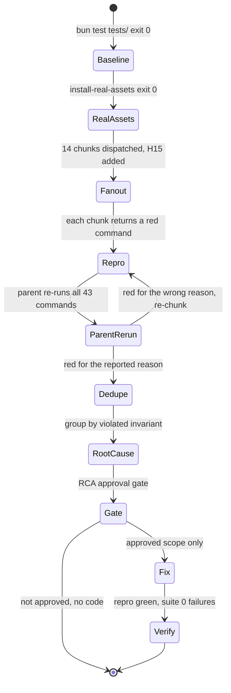

# Systematic Debugging Log: Snipset CLI v0.2.0 release bug hunt

## 1. Issue Summary

- **Request (2026-10-15):** find errors and bugs in the Snipset CLI as shipped in the latest release, so they can be patched.
- **Release under test:** `v0.2.0` (Draft). Assets verified with `sha256sum -c SHA256SUMS`: Linux tarball `57b43b6e...cfe5`, Windows zip `90d888f7...edcc`. The binary under test is the one extracted from that tarball (`snipset 0.2.0`, sha256 `c2205926...2967`). The installed `~/.local/bin/snipset` reports the same version but has a different hash (`b59ac735...c564`), so it is a local build and was not used.
- **Surfaces:** this repository (bash and PowerShell installers, `scripts/snipset-live.sh`, package manifests, README) and the release payload built in the private upstream repository `~/Proyek/Snipset` (the `snipset` binary from `crates/snipset-cli`, and the shell bundle from `scripts/distribution`).
- **Baseline:** `bun test tests/` on 8cd3341 exits 0 (590 pass, 6 skip, 0 fail, 210.13 s). `SNIPSET_REAL_ASSETS=~/.cache/parent-v020 bun test tests/install-real-assets.test.mjs` exits 0 (4 pass). Every defect below sits outside what the suite asserts.
- **Result:** 43 red repro commands, 15 discovery chunks, 37 unique defects after dedupe: 15 in this repository, 22 in the upstream payload. No hypothesis about the package manifests survived (H09 disproven).

## 1b. Debugging Loop



## 1c. Phase 0: Feedback Loop

No single user symptom existed, so the loop is per finding. Every chunk had to return one command that drives the real code path, exits non-zero because of the defect and 0 once fixed, runs in seconds, and needs no human. The parent re-ran all of them in one pass:

```sh
bash ~/.cache/parent-verify.sh   # four groups in parallel, one line per repro: id, exit code, seconds
```

Output on 2026-10-15: all 43 commands non-zero (41 exit 1, H07-a and H07-b exit 3), the slowest 3 s. The parent then read the tail of each log to confirm the red reason is the reported symptom, not a harness fault (for example H03-b ends `BUG: rc=1, binary placed: yes`, H15-a ends `FAIL: CLI reported success but the write is absent from --db`). Logs: `~/.cache/parent-verify/<id>.log`.

Safety envelope for every run: temp `HOME` with `XDG_*` inside it; the live database only read through `sqlite3 .backup` into `~/.cache/parent-v020/live-copy.db` and further copies; harness CLIs (`claude`, `codex`, `gemini`, `code`) shadowed by stubs (one sandboxed real `claude` call in H04 before the scope was narrowed, contained in its temp HOME); H15's fake control API bound 127.0.0.1:18317 after `ss -ltn` showed 8317 and 18317 free.

## 2. Phase 1: Deterministic Reproduction

| Chunk | Hypothesis | Verdict | Repro ids |
| --- | --- | --- | --- |
| H01 | clean `--from` install completes and `--check` says CURRENT | confirmed bug | H01-a, H01-b |
| H02 | install, update, uninstall leave no residue | confirmed bug (P3) | H02-a |
| H03 | argument parsing edges | confirmed bug | H03-a..d |
| H04 | `--with-mcp` configs | confirmed bug (P3) | H04-a..c |
| H05 | PATH and startup files | confirmed bug (dup of H03-a) | H05-a |
| H06 | release shell bundle at runtime | confirmed bug | H06-a..i |
| H07 | `snipset-live.sh` routing | confirmed bug (P3), no lost write | H07-a, H07-b |
| H08 | `install.ps1` with the real zip | confirmed bug (P3) | H08-a |
| H09 | package manifests | disproven | none |
| H10 | binary, database-only commands | confirmed bug | H10-a..d |
| H11 | binary, MCP stdio server | confirmed bug | H11-a..d |
| H12 | release resolution and download | confirmed bug | H12-a..d |
| H13 | README, help text, bundle drift | confirmed bug (dup of H03-c) | H13-a |
| H14 | binary, note/task/journal/clipboard/audio/pomodoro reads | confirmed bug | H14-a..e |
| H15 | bridge writes and `--db` (added after H10) | confirmed bug | H15-a |

Repro scripts live in `~/.cache/h<NN>-repro/`, outside the repository. The ones that back an approved fix are turned into tests in `tests/` before the fix.

## 3. Phase 2: Root Cause Analysis

Each finding was dedupe-checked by file and remedy: H05-a is H03-a (same `args.sh` loop, same fix) and H13-a is H03-c (same `install_dry_run` branch). The parent read every root-cause line cited below in the session worktree at 8cd3341 or in `~/Proyek/Snipset` at HEAD `ef61ef01c` before accepting it.

### 3a. This repository (fixable in this session)

| ID | Sev | Class | Defect | Root cause (violated invariant) |
| --- | --- | --- | --- | --- |
| R1 (H03-a, H05-a) | P1 | code | `--install-dir bin`, `--share-dir share`, `--db data/x.db` are written verbatim into `.bashrc`, `.profile`, `<share>/env`, and MCP configs. Every later shell searches `bin` relative to its own cwd, so any `bin/` in a directory you `cd` into can shadow commands; a login shell prints `share/env: No such file or directory`. | `scripts/installer/sh/args.sh:97-104` only rejects special characters. Invariant: a path written into a startup file or config never depends on the cwd at install time. `install.ps1` already resolves relative paths, so the installers disagree. |
| R2 (H03-b) | P2 | code | `--share-dir ''`, `--bashrc ''`, `--install-dir ''` pass parsing, fail later with a raw `mkdir`/`touch` error, exit 1, and leave the binary already placed; `--db ''` silently means the default. | `args.sh:59-64` checks that an argument follows, not that it is non-empty. Invariant (README "Exit codes"): a missing value is a usage error, exit 2, before any write. |
| R3 (H03-d) | P3 | contract | `--db --dry-run` takes `--dry-run` as the database and performs a real install; `--install-dir --dry-run` creates `./--dry-run` and dies in `mktemp`. | Same lines: a value starting with `-` is accepted. `binary.sh:21` calls `mktemp` without `--`. Invariant: a value flag never swallows the next flag; a dry run never writes. |
| R4 (H03-c, H13-a) | P3 | code | `--dry-run --version garbage` prints `use garbage` and exits 0; the real run exits 2 `invalid version`; `--dry-run --version 0.2.0` prints `0.2.0` where the real run uses `v0.2.0`. | `scripts/installer/sh/modes.sh:43-45`: `install_dry_run` calls `fetch_resolve_version` only when `--version` is empty. Invariant: a dry run refuses what the real run refuses. |
| R5 (H01-a) | P2 | code | `--bashrc ~/.config/bash/bashrc` in a directory that does not exist yet stops the install after the binary and bundle are placed: no database, no shims, exit 1, `--check` DRIFT. Masked whenever `--add-path` is also passed, which is what every existing test does. | `scripts/installer/sh/shell.sh:103` calls `touch_recorded "$bashrc"` with no `mkdir_recorded "${bashrc%/*}"`, while `modes.sh:155` already lists `${bashrc%/*}` as a directory the install creates and `pathenv.sh:50-51` creates it for its own line. Invariant: each write site creates its parent directory through `mkdir_recorded`. |
| R6 (H06-a) | P1 | code | `install.sh --db PATH` generates shims from PATH, but a new shell running a shim prints `snipset: expand failed for 'hii'`, because the shim reads `SNIPSET_DB` and nothing exports it. README:62 says `--db` is the database for shims. | `scripts/installer/sh/shims.sh:9` sets `SNIPSET_DB` only for the generator; the bashrc block (`shell.sh:88-95`) never exports it. Invariant: the database chosen at install time is the one the installed runtime pieces use. |
| R7 (H07-a, H07-b) | P3 | code | `snipset-live.sh note list` (and 23 other reads from groups added in 0.2.0: journal, task, note, settings, support, export, pomodoro status, doctor) and `--version`/`help` go through the doctor gate and are refused with exit 3 while the live file is locked, although the wrapper's own message says reads stay available. No write is lost (writes all route live). | `scripts/snipset-live.sh:66-77` allowlist covers only the six pre-0.2.0 groups; an empty `cmd` or `help` falls to the write path. `tests/snipset-live-cli-drift.test.mjs` only diffs subcommands inside those six groups, so new top-level groups never show as drift (the MEMORY.md rule predicted this). |
| R8 (H12-a, H12-b, H12-c) | P2 | code | Without `--version`, the latest lookup on 404 (today's answer, the release is a Draft) or 403 exits 22 (curl) or 8 with no output (wget), never printing `release version was not found`; a failed asset download exits 22 instead of 1. | `scripts/installer/sh/fetch.sh:57`: `version="$(fetch_text ... | sed ... | head)"` under `set -euo pipefail` (`lib.sh:7`) aborts on the failed assignment before the `die` on line 58; `fetch.sh:75-76` call `fetch_get` with no `|| die`. Invariant (README "Exit codes"): a failed download exits 1 with an `install.sh:` message. |
| R9 (H12-d) | P3 | code | `install.ps1` latest lookup on 404 surfaces GitHub's raw `HttpResponseException` JSON. | `scripts/installer/ps1/fetch.ps1:14`: `Invoke-RestMethod` outside any try, so the clear throw on line 15 never runs. |
| R10 (H08-a) | P3 | code | `install.ps1 -Version V0.2.0` is accepted (would request tag `V0.2.0` and 404); `install.sh` refuses it. | `fetch.ps1:11-12,15` use case-insensitive `-notmatch`/`-notlike`. Invariant: the tag is lowercase `vX.Y.Z` on both installers. |
| R11 (H04-a) | P3 | code | A cursor or opencode file that only holds another server running the same binary is reported `[KEEP] snipset is already registered` and `--check` says CURRENT, yet there is no `snipset` entry. | `scripts/installer/sh/mcp.sh:150` matches the binary path anywhere in the file; the gemini probe (`mcp.sh:84-95`) already scopes to the `snipset` object. |
| R12 (H04-b) | P3 | code | With `XDG_CONFIG_HOME` set, the opencode file goes to `~/.config/opencode/opencode.json`, which opencode v2.0.24 does not read (`opencode debug paths` reports `$XDG_CONFIG_HOME/opencode`). | `mcp.sh:10` hardcodes `${HOME}/.config`; `mcp.sh:12` (vscode) already honours `XDG_CONFIG_HOME`. README:67 and :146 document the hardcoded path. |
| R13 (H04-c) | P3 | contract | `--check --db B` reports CURRENT while the registered entries still pass `--db A`. | `mcp_check` (`mcp.sh:228-230`) compares the binary path only. Owner call: README asks for "the same flags". |
| R14 (H01-b) | P3 | contract | `--no-init --db X` then `--check` with the same flags reports `[MISSING] database` and DRIFT. | `db_check` (`scripts/installer/sh/db.sh:22-30`) ignores `do_init`; `install.ps1` reports MISSING on purpose. Owner call. |
| R15 (H02-a) | P3 | code | A pre-existing `.bashrc` or `.profile` without a final newline gets one added by install plus uninstall. | `shell.sh:104-108` and `pathenv.sh:52` prepend `\n`, which terminates the user's last line; the strip at `shell.sh:227-236` and `pathenv.sh:60-64` cannot tell it was missing. Invariant: uninstall restores a pre-existing file byte for byte. |

### 3b. Upstream release payload (private `~/Proyek/Snipset`, separate session and release)

None of these is fixed at upstream HEAD `ef61ef01c`. The only CLI commit after the release date is `519b1f797` (`settings.rs`, secrets).

| ID | Sev | Defect | Root cause |
| --- | --- | --- | --- |
| U1 (H15-a) | P1 | `snippet add`, `import`, `settings set/unset` with `--db <file>` report success but send the write to whichever app answers the control API port stored in that file; the file is unchanged. A copy of the live database carries the live token and port, so the write lands in the live database. | `crates/snipset-cli/src/bridge/mod.rs:38-58` reads enable flag, token, and port from `--db` and accepts any 200 from `/health`; nothing compares the app's database with `--db` (`main.rs:183-203`, `:1733-1754`, `settings.rs:155-183`). |
| U2 (H10-a) | P1 | JSON export then import drops group, matching mode, case sensitivity, enabled, favorite, hotkey with `failed 0`; 102 of 115 live snippets lost their group. | `export.rs:20` writes `group_id` with no group name; `import/json.rs:55` reads only `group`; `import/mod.rs:125-127` hardcodes Strict, CaseSensitive, enabled. |
| U3 (H14-a) | P1 | `audio dictionary list` (and MCP `list_audio_dictionary`) fails on every app-created database: `Invalid column type Integer ... created_at`. | `audio/dictionary.rs:18,55` read `created_at` as `String`; commit `5d814e164` moved the column to INTEGER millis but left this reader; the `init` schema (`db/init.rs:88`, TEXT) and the text fixture hide it. |
| U4 (H14-e) | P2 | Text output piped into `head -1` panics on EPIPE and aborts with a core dump (exit 134). | Per-line `println!` with SIGPIPE ignored, plus workspace `panic = "abort"`. |
| U5 (H14-b) | P2 | `audio stats --range today` counts everything (116 vs 39 on the live copy); `by_day` is all `unknown`. | `audio/stats.rs:37-39,101` compare epoch milliseconds with seconds. |
| U6 (H10-b) | P2 | `snippet add` accepts a blank keyword, name, or content; `import` rejects the same row. | `snippet/write.rs:104-112,137-144` check uniqueness only. |
| U7 (H10-c) | P2 | `doctor --json` prints nothing on stdout for a non-WAL or non-SQLite file. | `doctor.rs:44` opens through `db::open`, which refuses non-WAL before the report is built. |
| U8 (H11-a) | P2 | MCP tool failures return `isError:false` with an `{"ok":false}` body. | `mcp/server.rs:71-73` returns a plain `String` for failures. |
| U9 (H06-b) | P2 | `sx`, `sxx`, and the Enter trigger ignore `SNIPSET_DB`. | `scripts/distribution/shell/snipset.sh:14,18,28,34` never pass `--db`. |
| U10 (H06-c) | P2 | An extra argument starting with `-` breaks expansion (`sx ,eclip --fix`, shim `hii --fix`). | `--clipboard "$X"` instead of `--clipboard="$X"` in `snipset.sh` and `snipset-shims.sh:92,94`. |
| U11 (H06-d) | P2 | TAB does not expand an exact keyword that is also a prefix of another (`,gc` vs `,gcheck`). | `scripts/distribution/shell/snipset-tab.sh:172-184` requires a unique match. |
| U12 (H06-g) | P2 | A shim named like a real command (`ls`) shadows it, and TAB expands it. | `snipset-shims.sh:62-72` checks only the shim directory. |
| U13-U22 | P3 | H06-e (completion after `--db`), H06-f (paths with spaces in completion), H06-h (plain re-run makes `--prune` forget stale shims), H06-i (Enter trigger cannot `cd`; bash subshell limit), H10-d ("schema mismatch:" on user errors), H11-b (`serverInfo` says `rmcp 3.4.0`), H11-c (malformed JSON dropped without -32700), H11-d (invalid enum values coerced to defaults), H14-c (invalid filter values ignored), H14-d (`audio history list --limit 0` returns 50). | See the chunk reports quoted in the progress log. |

### 3c. Systematic root causes

1. **Installer input boundary validates characters, not shape** (R1, R2, R3): one normalisation step in `args.sh` (non-empty, not a flag, made absolute) closes all three.
2. **Dry run does not share the real run's validation** (R4).
3. **Parent-directory creation is per call site** (R5): the record helper exists, one site skipped it.
4. **`--db` stops at install time** (R6 here, U9 upstream): the shims and helpers read `SNIPSET_DB`, which the installer never exports.
5. **Checks compare a weaker identity than install writes** (R11, R13, R14).
6. **The wrapper allowlist and its drift test are frozen at the pre-0.2.0 command tree** (R7).
7. **`set -e` aborts before the intended `die`** (R8), and the PowerShell sibling has the same gap (R9).
8. **Upstream: `--db` is not the authority for writes when the control API answers** (U1), and **schema or unit drift between app and CLI** (U3, U5).

## 4. Phase 3: Smallest Safe Localized Fix

Approved at the RCA gate on 2026-10-15 (F1 to F9; R13 and R14 kept as documented behaviour; upstream U1 to U22 to a separate session). Each fix landed test first in its own chunk against a private bundle of HEAD parts plus the chunk's part.

| Task | Findings | Files | Fix | RED then GREEN |
| --- | --- | --- | --- | --- |
| T01 | R1, R2, R3 | `args.sh`, `binary.sh` | `path_arg` refuses an empty or dash-led path value (exit 2); relative paths become absolute against `$PWD`; `mktemp -d --` | 0/8 then 8/8 |
| T02 | R4 | `modes.sh` | the dry run always calls `fetch_resolve_version` and prints the normalised version | 1/4 then 4/4 |
| T03 | R5, R6, R15 | `shell.sh` | `mkdir_recorded` for the `--bashrc` parent; `export SNIPSET_DB` in the block with `--db`; older and other-database blocks are recognised, rewritten in place, and removed; a missing final newline is restored | 8/12 then 12/12 (after the review follow-up) |
| T04 | R15 | `pathenv.sh` | the strip keeps a file without a final newline that way | 1/2 then 2/2 |
| T05 | R7 | `snipset-live.sh`, drift test | 0.2.0 read leaves on the snapshot; help and version skip the gate; the drift test walks every top-level group | 9/39 then 39/39 |
| T06 | R8 | `fetch.sh` | `|| version=''` before the existing `die`; `fetch_get ... || die "download failed: <url>"` | 0/5 then 5/5 |
| T07 | R9, R10 | `fetch.ps1` | case-sensitive version checks; the latest lookup in try/catch with the HTTP status | 0/2 then 2/2 |
| T08 | R11, R12 | `mcp.sh`, `modes.sh` | the probe reads the `snipset` entry's own command (one nested object stepped over); opencode honours `XDG_CONFIG_HOME` and still finds a v0.2.0 file under `~/.config`; uninstall removes the empty v0.2.0 dirs | 1/4, 4/5, 5/6, 6/7 then 7/7 |
| T10 | R11, R12 sibling | `mcp.ps1` | parsed probe; XDG on non-Windows; v0.2.0 opencode fallback | 1/6, 6/7 then 7/7 |
| T09 | all | `install.sh`, `install.ps1`, `README.md`, two test pins | regenerated bundles; README rows for `--db`, exit code 2, relative paths, opencode path, live-wrapper reads; `--help` text | `build.mjs --check` exit 0 |

Confirmed hypothesis per family (for the commit and PR): the installer validated the characters of a path, not its shape; the dry run skipped the version rule; one write site skipped `mkdir_recorded`; `--db` stopped at install time; probes matched text anywhere in a file instead of the `snipset` entry; the live-wrapper allowlist was frozen at the pre-0.2.0 tree; `set -e` aborted a failed fetch before its `die`.

## 5. Phase 4: Regression Verification

| Check | Command | Exit | Result |
| --- | --- | --- | --- |
| Bundles match parts | `bun scripts/installer/build.mjs --check` | 0 | both targets |
| Whole suite | `bun test tests/` | 0 | 702 pass, 6 skip, 0 fail, 708 tests, 49 files, 161.09 s |
| Real v0.2.0 assets | `SNIPSET_REAL_ASSETS=~/.cache/parent-v020 bun test tests/install-real-assets.test.mjs` | 0 | 4 pass |
| Repo-side repros | `bash ~/.cache/parent-verify-fixed.sh` | see log | 21 of 22 exit 0; H04-a exits 1 only on a harness line that demands a `snipset` entry in a user's own cursor file, which the installer never writes; its defect lines are absent; X-H01-b and X-H04-c (R14, R13) stay red as approved |
| shellcheck | `shellcheck -s bash scripts/installer/sh/*.sh scripts/snipset-live.sh` | 0 except `pathenv.sh` | one SC2016 info in `pathenv.sh`, pre-existing at HEAD |
| Two-axis review | `staid` standards and spec reviewers | n/a | one P1, one P2, two P3 found and fixed, each RED then GREEN; `review-report.md` |

One run of the whole suite (`parent-full-suite3`) had 2 failures in `tests/pentest-core.test.mjs` (a real `snipset` child killed at the 5 s test timeout while the machine load average was 7 to 9 from other sessions). That file and the `snipset` on PATH are untouched by this diff; the file alone passed 9/9 and the next whole run was clean. Classified `environment` in the Error Ledger.

No `[DEBUG-` tag was used in this session.
